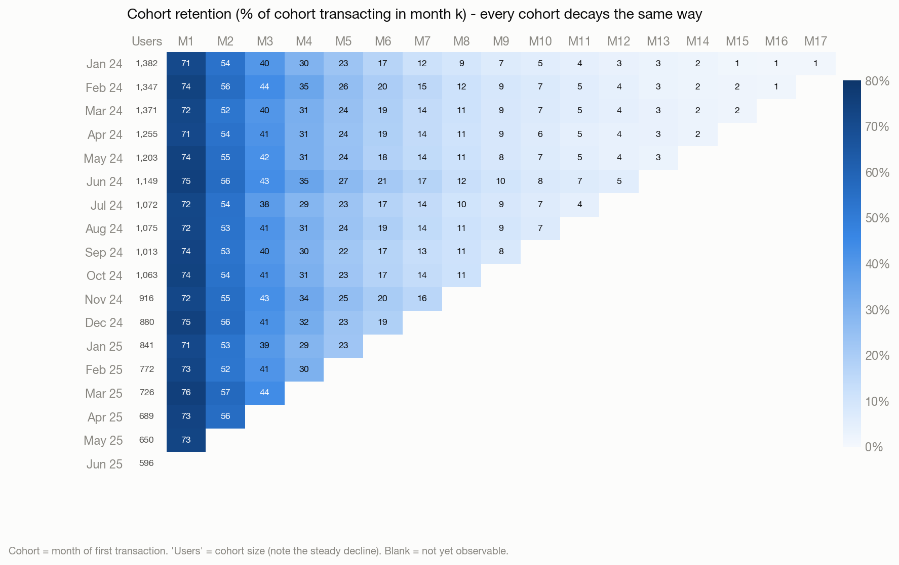
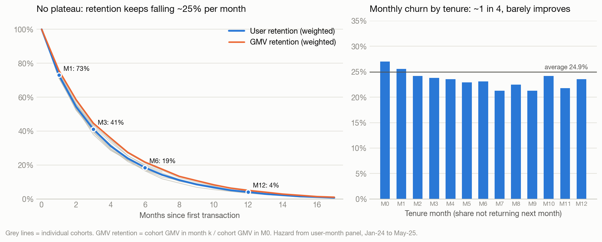
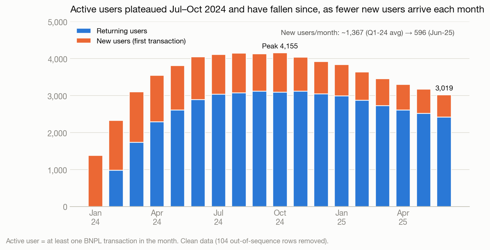
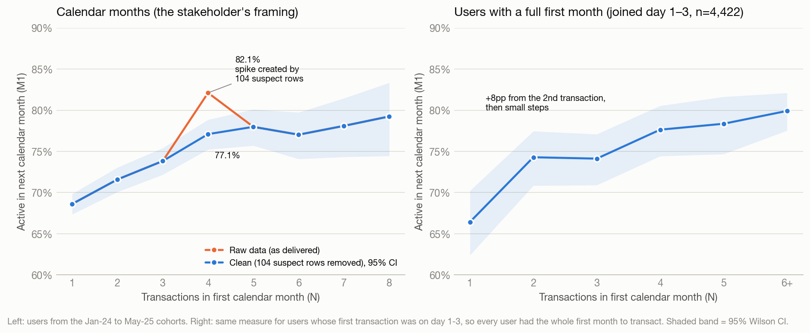
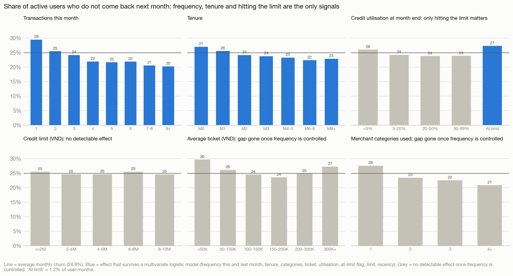
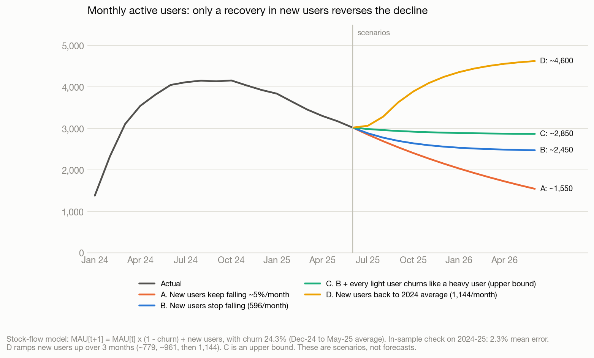
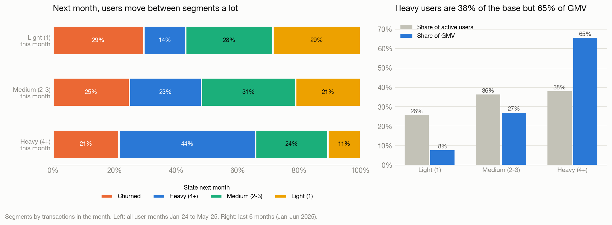
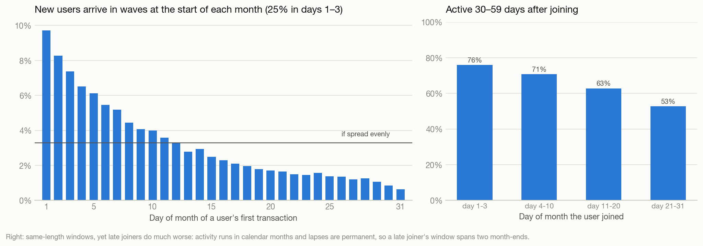
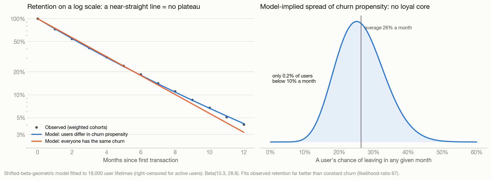

# BNPL Retention & Churn: Take-Home Solution

**Role:** BI Analyst, Credit Enablement · **Data:** `data.csv` (BNPL transactions) · **Reproduce:** `python3 AI_solution/analysis.py`. Every number below is written to `outputs/key_numbers.json`.

---

## Executive summary

1. **The business is shrinking because fewer new users arrive, not because users leave faster.**
   - Monthly active users (MAU) held at ~4,100–4,150 from Jul to Oct-24. They have since fallen **27% to 3,019** (Jun-25).
   - New users fell from ~1,370 a month in Q1-24 to **596** in Jun-25 (**−56%**), about **5% a month**. Retention did not change.
   - We now lose about **750** active users a month and gain about **600**.
   - *Before escalating, reconcile this decline with the official acquisition dashboard. The extract holds exactly 18,000 users and may be a sample.*
2. **Retention is stable over time but never stops leaking.**
   - All 17 cohorts with an observable M1 follow the same curve: **73% at M1, 41% at M3, 19% at M6, 4% at M12**.
   - About 1 in 4 active users drops out every month, at every tenure.
   - **None of the 14,231 lapsed users who had time to come back ever did.**
3. **Q1c is true in direction but false as a threshold.**
   - M1 retention rises with first-month transactions, from 69% at 1 to 77–79% at 4–8.
   - Splitting users at any N from 2 to 8 gives about the same gap (+5.6 to +6.8pp), so **no N is special**.
   - The raw file's sharp N = 4 (82%) is created by **104 suspect rows**.
   - Each of the first few transactions adds a little (about 2–4pp of M1), and the curve then flattens. If the business wants an onboarding milestone, the **2nd transaction** is the most practical, because 31% of new users stop at one. Expect a small effect and test it; this is a correlation, not proof of cause.
4. **Churn is linked to usage frequency, but only weakly.**
   - 29.5% of users with one transaction in a month do not return, against 21.5% of users with 4+.
   - Tenure and maxing out the credit line add a little. Limit size, ticket size and merchant category show no detectable effect.
   - A transaction-only model barely beats chance (AUC 0.56), so most churn drivers are outside this data.
   - The practical trigger is **mid-month silence**: of last month's users with no transaction by day 15, 61% are gone for good.
5. **Retention alone cannot stop the decline.**
   - Holding 3,000 users needs ~730 new users a month (+23%), or churn below 20%.
   - Even the best case in the data, where every user with 1–3 transactions a month churns like a 4+ user, only gets churn to ~21%.
   - So: **(1)** recover new-user inflow. By Jun-26 that means ~4,600 active users at the 2024 inflow level, ~2,450 if inflow just stops falling, and ~1,550 if it keeps falling. **(2)** Test a mid-month reminder and **(3)** frequency rewards for users with 1–3 transactions a month. **(4)** Find out why lapsed users never return before trying any win-back. **(5)** Quarantine the 104 suspect rows, and prefer a 2nd-transaction milestone to a "≥4 transactions" target.
6. **Beyond the brief** (Bonus section). The three that matter most:
   - Heavy users are 38% of the base but 65% of GMV.
   - Users stop abruptly instead of fading, and even long-tenured users still churn at 21–24% a month, so no loyal core forms.
   - A new user generates ~2.3M VND of GMV over their lifetime.

**Data notes** (full log in Appendix A):
- The file covers **18 months** (Jan-24 to Jun-25), not the 6 the brief mentions: 204,694 transactions from 18,000 users. I used all of it.
- **104 suspect rows (TXN00204591–TXN00204694)** break an otherwise perfect ID sequence. They change the Q1c answer and nothing else (every cohort's M1 moves by less than 1pp), so I quarantined them.
- All results use the remaining 204,590 rows unless labelled *raw*.

---

## Part 1: Retention

### Q1a. Definition

> **A user is retained in month k (M*k*) if they make at least one BNPL transaction in the k-th calendar month after their first-transaction month (their cohort).**
> Retention(cohort *c*, M*k*) = users of *c* with ≥1 transaction in month *c+k* ÷ users in *c*.

1. **A transaction is the value event.** BNPL earns only when the credit line is used, and transactions are the only behaviour this file contains. The ideal definition for a credit product would also require good repayment standing, which this data cannot show.
2. **Monthly matches the billing cycle** (spend → statement → repay → spend). The median active user transacts 3 times a month, so weekly retention would flag normal gaps as churn, and quarterly would be too slow to act on.
3. **The cohort starts at the first transaction**, the first moment of value. The file has no signup or approval date.
4. **The bar is ≥1 transaction, not a GMV floor.** Ticket sizes are similar across users (median 133K VND) and do not predict churn. GMV retention is tracked alongside as the value view.
5. **Calendar months match billing and reporting.** M0 is a partial month for late joiners, so Q1c is re-tested on users with a full first month. The bias is limited, because 76% of users make their first transaction by the 15th. Activity also runs in calendar months, which makes them the natural unit (Bonus B3).
6. **Classic and "unbounded" retention are the same here**, because no user ever returns after a fully inactive month.

Companion metrics are **GMV retention** (cohort GMV in M*k* ÷ cohort GMV in M0) and **monthly churn** (users active in month *t* with no transaction in *t+1*).

### Q1b. Cohort retention

| Weighted average across cohorts | M1 | M2 | M3 | M6 | M9 | M12 |
|---|---|---|---|---|---|---|
| User retention | **73.0%** | 54.3% | 41.2% | 18.5% | 8.6% | **4.1%** |
| GMV retention | 75.8% | 58.5% | 44.7% | 21.7% | 10.8% | 5.0% |

**What the cohorts show**

1. **Retention is stable over time.** Across the 17 cohorts with an observable M1, M1 ranges from 71.1% to 75.6% and M3 from 38.0% to 43.9%. A chi-square test across cohorts finds no real difference (p = 0.51 for M1, 0.20 for M3, 0.16 for M6). Nothing in 18 months moved retention.
2. **There is no plateau.** About 1 in 4 active users stops every month: 27.0% after M0, 25.5% after M1, then about 23.5% a month from M2 to M8.
   - Retention halves roughly every 2.4 months, and only 4% of a cohort is left at M12.
   - The average user is active for 4.0 months (Jan–Jun-24 cohorts).
   - 27% of users never return after their first month, so the first billing cycle is the biggest single leak.
3. **Heavier users survive, but nobody's usage grows.** Transactions per active user rise from 3.0 in M0 to 3.8 at M10+, so GMV retention runs about 3pp above user retention. Yet the *same* users do not use BNPL more over time: users active 9+ months made 3.73 transactions in M0 and 3.59 in M8. Light users simply leave first.

**Anomalies**

4. **Lapses are permanent.** None of the 14,231 lapsed users who had at least one later month to come back ever transacted again, including users who had a year or more.
5. **Cohorts shrink every month.**
   - New users fell from ~1,370 a month in Q1-24 to 596 in Jun-25 (−56%, or −5.3% a month).
   - With retention stable, this drives MAU (−27% from the Jul–Oct-24 plateau) and GMV (−23% from the Nov-24 peak) (Fig. 1).
   - New cohorts look the same as old ones: average limit 5.05–5.39M VND, first ticket 164–175K VND, and a category mix that moved less than 1pp between the first and last quarter.
   - The only blip is Oct-24, with 1,063 new users against ~940 on trend (+13%). Was there a campaign?
6. **New users arrive in monthly waves.** First transactions cluster at the start of every month: 25% in days 1–3, where an even spread would give 10%, and 76% by the 15th.

**Hypotheses on the causes, and the data that would test them**

| Pattern | Most likely explanations | Data needed |
|---|---|---|
| No plateau; the biggest drop is right after M0 | (a) Friction at the first statement or repayment (fees, late-payment experience). (b) Usage driven by one-off promotions. | Repayment, DPD and fee data per user; campaign attribution of the first transaction |
| 0% reactivation | (a) Accounts frozen or limits revoked after a missed cycle or inactivity. (b) The extract keeps only each user's first active streak. | Account-status and limit-change logs; whether lapsed users can still transact |
| Shrinking cohorts with unchanged quality | Smaller monthly onboarding waves (eligibility lists or marketing budget) rather than stricter scoring. Stricter scoring would usually shift limits and retention, and neither moved. | Monthly funnel by channel (eligible → invited → approved → first transaction) and marketing spend |

### Q1c. "Users with ≥ N transactions in their first month retain better in M1"

> **Verdict: true in direction, false as a threshold.** Users with more first-month transactions are somewhat more likely to return in M1: 69% at N = 1 against 77–79% at N = 4–8. But no N is special. Splitting at any N from 2 to 8 gives a similar gap (+5.6 to +6.8pp). The raw file's apparent N = 4 is created by 104 suspect rows. Each of the first few transactions adds a little, and the curve then flattens. **If the business wants an onboarding milestone, the 2nd transaction is the most practical one**, because 31% of new users stop at one. Expect a small lift of a few points of M1, and test it before setting a target.

| N (first-month txns) | Users | % of new users | M1 raw | M1 clean |
|---|---|---|---|---|
| 1 | 5,414 | 31% | 68.6% | 68.6% |
| 2 | 3,531 | 20% | 71.6% | 71.6% |
| 3 | 2,843 | 16% | 73.8% | 73.8% |
| **4** | 2,074 | 12% | **82.1%** | **77.1%** |
| 5 | 1,358 | 8% | 78.0% | 78.0% |
| 6 | 849 | 5% | 77.0% | 77.0% |
| 7 | 516 | 3% | 78.1% | 78.1% |
| 8 | 318 | 2% | 79.3% | 79.3% |
| 9+ | 501 | 3% | 78.0% | 78.0% |

**How I got there**

1. **The raw data seems to confirm N = 4.** ≥4 vs <4 gives 79.5% vs 70.8% (+8.7pp), the best cut of any N.
2. **But the shape is implausible.** Users with *exactly* 4 transactions (82.1%) retain better than users with 5–8 (77.9%, p = 0.0003). Engagement effects do not peak and then fall back like that.
3. **Tracing the spike.**
   - The extra retention comes from 104 rows at the end of the ID sequence, outside their users' otherwise contiguous ID blocks.
   - Each belongs to a user with **exactly 4 transactions, all in M0**, and each lands in **M1**, 4–41 days later. Together they turn 104 of the 475 "4 transactions, no M1" users into retainers.
   - They also contain all 5 package/carrier mismatches in the file and all 5 cases where a balance jumped by more than the purchase.
   - Their balances fall from the previous transaction 57% of the time, against 29% for organic transactions after a similar gap.
   - They are very unlikely to be organic. Data engineering should confirm whether they are test data or a mis-loaded batch. The list is in `outputs/tables/dq_out_of_sequence_rows.csv`.
4. **The clean result.** N = 4 drops to 77.1%, in line with N = 5–8 (77.9%, p = 0.54). ≥4 is still marginally the best cut (+6.8pp), but every N from 2 to 8 gives +5.6 to +6.8pp.
5. **The fair comparison.** Calendar months favour early joiners: only 4% of users who join after the 15th reach 4 transactions, against 41% of earlier joiners. So I re-ran the test on the 4,422 users whose first transaction fell on day 1–3, which gives everyone a full first month (right panel). M1 goes 66% → 74% → 74% → 78% → 78% → 80% for 1 → 6+ transactions. The same gradual rise appears, but this group is a selected 25% of users, and the +8pp step from 1 to 2 carries a ±5pp margin. Across all users, a regression with cohort and join-week controls puts the first steps at a similar size (1→2: +0.12, 2→3: +0.11, 3→4: +0.18 in log-odds). **No single step dominates.**
6. **Why not equal 30-day windows?** That view shows a +17pp jump from 1 to 2 transactions (46% → 63%), but most of it is mechanical, because activity runs in calendar months and lapses are permanent (Bonus B3). For someone who joined after the 20th, "one transaction in 30 days" usually means they made no purchase in their second calendar month, i.e. they have already left: only 17% of them are active later, against 58% of those with two transactions. Details are in Appendix B.

**What the data suggests instead**

- **Track the 2nd transaction as a practical milestone, not a magic number.** 31% of new users make only one transaction in their first calendar month. Many of them joined late in the month; among users with a full first month the figure is 13%. Most second purchases happen within two weeks (Bonus B4), so that is the natural window for a nudge.
- **Frequency matters every month**, not only in month one (Part 2).
- **This is a correlation.** Proving causation needs a randomised 2nd-purchase incentive.
- **Value context.** Users with 5+ first-month transactions generated 3.8× the lifetime GMV of 1-transaction users (4.21M vs 1.11M VND, including M0, Jan–Jun-24 cohorts). That is mostly because they buy more often (25 vs 6.5 lifetime transactions). They stay only 1.4 months longer (4.8 vs 3.4).

> **For the stakeholder:** 104 suspect rows inflate the N = 4 result (+8.7pp instead of +6.8pp) and make exactly 4 look special. A "≥4 transactions" target is no better than 3 or 5. Prefer a 2nd-transaction milestone, which is easier to act on.

---

## Part 2: Deep-dive, Option A (Churn)

**Why churn.** I screened for growth first. No segment is outgrowing the others: the category mix is stable, and new cohorts have the same limits, tickets and retention. Churn is not what changed, but at 25% a month it caps how big the base can get, and it is the only place where user behaviour differs. Section 2.5 weighs churn levers against inflow.

### 2.1 Definition

**Churned = active in month *t*, with no transaction in month *t+1*.** Lapses are permanent here, so this is final.
- **14,981 of 18,000 users (83%) have churned**, and 3,019 were active in Jun-25.
- Monthly churn averages **24.9%**. It was 28.9% in Jan-24, when every user was brand new, and has stayed between 23.5% and 26.3% every month since.

### 2.2 How churners differ from users who stay

| Signal (share not returning next month) | Higher risk | Lower risk |
|---|---|---|
| Transactions this month | 1 txn: **29.5%** | 4+ txns: **21.5%** |
| Last month, then this month | 1 → 1: **31.6%** | 4+ → 4+: **20.2%** |
| Tenure | M0: 27.0% | M6–8: 22.4% |
| Credit line at month end | At the limit: 27.3% (1.2% of user-months) | Below the limit: 24.9% |

**No detectable effect once frequency is controlled** (likelihood-ratio tests, all p > 0.5):
- **Credit-limit size:** 24.5–25.5% churn in every band.
- **Utilisation below the limit.**
- **Ticket size and number of merchant categories:** their raw gaps disappear, because heavy users naturally spread across more merchants.
- **Recency within the month.**

**Mid-month silence is a practical trigger.** Take the users who were active last month:
- By day 15, 41% have not transacted. 61% of those will not transact at all that month and, since lapses are permanent, are gone for good (vs 25% on average).
- By day 10 the figures are 52% silent and 48% lost. By day 20 they are 34% and 73%.
- This is a targeting rule, not a forecast, since every churner is silent by definition. It tells CRM who to reach while there is still time.

| Profile: the month before leaving vs months followed by more activity | Stayed | Churned |
|---|---|---|
| Avg transactions in the month | 3.32 | 2.98 |
| Share of 1-transaction months | 25.8% | 32.5% |
| Share of 4+ transaction months | 37.6% | 31.0% |
| Avg ticket (VND) | 169K | 170K |
| Merchant categories used | 1.93 | 1.80 |
| Median utilisation at month end | 6.9% | 6.4% |
| Avg credit limit (VND) | 5.25M | 5.22M |

At user level, churned users made fewer transactions from day one: 2.96 vs 3.38 in their first month, and 80.5% vs 91.4% made a 2nd transaction within 30 days.

### 2.3 How predictable is churn, and who to target now

I trained a logistic model on months up to Dec-24 and tested it out-of-time on Jan–May-25. It reaches **AUC 0.56**: the riskiest decile churns at 30.8% vs 19.7% for the safest. Transaction data alone cannot single out churners, so target with simple tiers and the silence trigger, and add repayment, app-activity and campaign data to do better.

| Tier (Jun-25 active users) | Users | Expected churn next month |
|---|---|---|
| High: 1 transaction in June | 752 | 29.5% |
| Medium: 2–3 transactions | 1,086 | 24.8% |
| Low: 4+ transactions | 1,181 | 21.5% |
| **Total** | **3,019** | **≈ 745 users expected to churn in July** |

### 2.4 Credit lens

Churners' balances at their last purchase look like everyone else's: 99.96% vs 99.91% carry a balance, averaging 409K vs 434K VND. Nothing here says churners are over-extended. Whether the 6.1B VND they left behind was repaid needs repayment and DPD data, and Risk should check it before any win-back.

Users who max out their line churn slightly more (27.3% vs 24.9%). This is rare outside small limits: 38% of users with limits ≤1M VND hit their limit at some point, against almost none above 3M.

### 2.5 Recommendations

**The arithmetic first.** We lose ~750 active users a month and gain ~600. Holding 3,000 users needs ~730 new users a month (+23%), or churn under 20% (today it is 24%). The best case in this data, every user with 1–3 transactions churning like a 4+ user, only gets churn to 21%. Retention work helps, but only inflow can reverse the decline.

| Lever (extra active users by Jun-26 vs. "new users stop falling" ≈ 2,450) | Assumption | Size |
|---|---|---|
| Recover new users to the 2024 average | 596 → 1,144 a month over 3 months | **+2,150** |
| Frequency rewards for users with 1–3 transactions a month | Upper bound: every 1–3 txn user churns like a 4+ user | up to ~+390 |
| Mid-month reminder to silent users | Saves 1 in 10 users who would otherwise be lost | +270 |
| Second-purchase offer for new users | Upper bound: every 1-transaction new user makes a 2nd purchase, worth +3pp M1 each | up to ~+20 |
| Higher limits for users who hit theirs | Upper bound: they churn like everyone else | ≈ 0 |
| Win-back of dormant users *(illustration)* | 1% of ~15,000 come back each month (0% seen so far) | +600 |

| # | Action (proposed owner) | Why | Test / KPI |
|---|---|---|---|
| 1 | **Recover new-user inflow** (Growth + Risk). First reconcile the −56% with the official dashboard, then find which onboarding step shrank: eligible → invited → approved → first transaction. | The decline is inflow-driven, and this is the biggest lever. | New users/month; ~730 a month holds today's base. |
| 2 | **Mid-month reminder** to users who haven't transacted by day ~10–15 (CRM). | 61% of day-15 silent users are lost for good. | A/B test with a holdout. KPI: % of silent users who transact by month end. Watch notification fatigue and cost. |
| 3 | **Frequency rewards for users with 1–3 transactions a month**, segmented on a 2–3 month average, plus a 2nd-purchase offer for new users (Product + CRM). | 1-transaction months churn at 29.5% vs 21.5% for 4+. | Randomised test with a holdout, because many users move up on their own. KPIs: share of MAU with 4+ transactions; 2nd purchase within 14 days. |
| 4 | **Ask why lapsed users never return, then pilot a win-back** on a small random sample of dormant users with no overdue balance (Risk + CRM). | 0 of 14,231 returned, possibly because of a lock policy. The dormant pool is 5× MAU. | Reactivation and repayment rates in the pilot before scaling. |
| 5 | **Fix the data before setting targets** (BI + Data Eng). | The 104 suspect rows created the N = 4 spike, and balances sit capped at the limit (Bonus E2). | Root-cause the load. Add repayment, account-status and app-event data to the churn model. |

**Don'ts:**
- Don't use limit increases as a retention tool. Users use about 7% of their line, and even fixing churn for capped users adds almost nothing.
- Prefer a 2nd-transaction milestone to a "≥4 transactions" target.

---

## Part 3: One page for the Business Lead

*(Formatted, printable version: `one_pager.html`. The text is identical.)*

**BNPL is shrinking because fewer new users join, not because users leave faster.**

| Active users, Jun 2025 | New users per month | Active users lost every month |
|---|---|---|
| **3,019**: down 27% from Jul–Oct 2024 (~4,150) | **596**: down 56% from early 2024 (~1,370) | **1 in 4**: unchanged for 18 months, and none came back |

If new users keep falling at today's pace, we end Jun 2026 with about 1,550 active users. If they just stop falling, we end with about 2,450. Back at 2024 levels, we end with about 4,600.

**What is happening**
- Active users are down 27% since autumn 2024. Payment volume is down 23% from its Nov 2024 peak.
- New users per month have more than halved and are still falling about 5% a month.
- We lose about 750 active users a month and gain about 600, so the base shrinks every month.
- Only 4% of new users are still using BNPL a year later. None of the people who stopped came back.

**Why**
- **Fewer people are joining.** New users look the same as before (same credit limits, same spending); there are just fewer of them. This still needs to be confirmed against the official acquisition numbers.
- **Light users leave first.** People who use BNPL once in a month are more likely to stop (29%) than people who use it four or more times (21%), and people don't use it more over time.
- **Credit limits are not what holds users back.** Users use only about 7% of their limit, and limit size, purchase size and shopping category show no link to leaving. Repayment behaviour isn't in this data and still needs checking.

**What we should do next**

| # | Action | Proposed owner | Why it matters |
|---|---|---|---|
| 1 | Find where new-user numbers fell (approvals, marketing, partner traffic) and fix it | Growth + Risk | The biggest lever: about 2,150 more active users by Jun 2026 than if new users just stop falling |
| 2 | Remind users who haven't used BNPL by mid-month (test on a sample first) | CRM | 6 in 10 of them would otherwise be gone for good. Saving 1 in 10 of those adds about 270 active users in a year. |
| 3 | Reward people who use BNPL only a few times a month for using it more often (test first) | Product + CRM | Occasional users leave the most. Worth up to about 390 active users in a year. |
| 4 | Ask Risk why people who stop never come back (account lock?) before testing any win-back offer | Risk + CRM | About 15,000 former users; the response is unknown. |

**Decision needed:** approve the review of where new users dropped (two weeks) and the two tests (actions 2 and 3).

*Active user = made at least one BNPL purchase that month. A data error made "4 purchases in the first month" look like a magic number. It isn't, and the data team should fix the source. The lines above are scenarios, not forecasts.*

---

## Bonus: extended findings (beyond the brief)

Each finding comes with a takeaway. Numbers are in `key_numbers.json` (keys `x_…`) and the `x*` tables. "Light / medium / heavy" here means 1 / 2–3 / 4+ transactions in a month.

### A. Where the value is

**A1. Heavy users are 38% of the base but 65% of GMV.**
- Over the last 6 months, heavy users spent ~980K VND a month, medium users ~420K and light users ~170K.
- Light users are 26% of active users but only 8% of GMV.
- Over a lifetime, the top 10% of users generate 39% of GMV and the top 20% generate 58%.
- *Takeaway: protect heavy users first; they carry the GMV.*

**A2. The base is getting heavier as it shrinks.**
- Heavy users went from 36% of MAU (Jun-24) to 39% (Jun-25).
- Transactions per active user rose 6% since Oct-24, while MAU fell 27%. Survivors are heavier users, and fewer new users arrive.
- *Takeaway: "GMV per active user" makes the business look healthier than it is. Always show it next to MAU and new users.*

**A3. Growth view (Option B, in brief): frequency is a small GMV lever next to inflow.**
- Moving an extra 10% of medium users up to 4 transactions adds about **+1.6% of monthly GMV**.
- Moving 10% of light users to 2 transactions adds about +0.7%.
- 23% of medium users already reach 4+ in any given month on their own, so a programme pays for many moves it didn't cause.
- *Takeaway: the 2–3 transaction group is the cheapest step up. Run any frequency programme against a holdout and judge it on incremental GMV.*

**A4. A new user generates ~2.3M VND of GMV over their lifetime.**
- The survival model (C1) gives an expected **4.1 active months** and **~2.29M VND lifetime GMV** (undiscounted) per acquired user.
- The 3-month GMV per new user is stable across cohorts (1.12–1.26M VND), so cohort quality is not slipping.
- *Takeaway: gross revenue per acquired user ≈ take rate × 2.3M VND, before funding cost and credit losses. Finance can turn that into an acquisition-cost ceiling.*

### B. How users behave

**B1. Monthly frequency is noisy, so one quiet month says little.**
- 14% of light users are heavy the next month, 11% of heavy users drop to light, and only 44% of heavy users stay heavy.
- Within a user, active-month counts vary about as much as random draws around a personal rate would (variance/mean 0.84, close to the ~0.85 that pure chance gives for counts of at least 1).
- *Takeaway: classify users on a 2–3 month average, not a single month.*

**B2. Users don't fade out; they stop abruptly.**
- Users transacting at less than half their own usual rate churn at 23%, the same as users near their usual rate (23–24%).
- *Takeaway: there is no slowing-down phase to detect, which is why prediction is weak (AUC 0.56). Act on silence within the month instead (2.2).*

**B3. Activity runs in calendar months.**
- With the same 30-day window, users who joined on day 1–3 are 76% active 30–59 days later, against 53% for users who joined after the 20th.
- That follows from activity being counted per calendar month with lapses being permanent: a late joiner's window spans two month-ends.
- Churn does not depend on the day of the last purchase (p = 0.16).
- Statement or due dates are a plausible driver, but the file has none, so that link is unproven.
- *Takeaway: measure retention in calendar months, and A/B-test reminder timing (mid-month vs just before month-end).*

**B4. Second purchases come early.**
- Among users who make a second purchase, the median gap is 8 days (about what 3 purchases a month implies), 71% happen within 14 days and 92% within 30.
- *Takeaway: the natural nudge window for new users is the second week after the first purchase.*

### C. Retention structure

**C1. There is no loyal core.**
- Observed monthly churn is still 21–24% at M9–M12, about as high as in the first months.
- A shifted-beta-geometric model, which lets every user have their own churn propensity, fits retention far better than a constant-churn model (likelihood ratio 67; M1 73.7% vs 73.0% observed, M12 4.2% vs 4.1%).
- The model implies propensities averaging 26% a month with a narrow spread (SD 7pp). Only 0.2% of users would be below 10% a month, and about 0.4% of a cohort would still be active at M24 (an extrapolation).
- *Takeaway: a loyal base will not emerge by itself. Gains must come from changing behaviour, not from waiting for a core to form.*

### D. Categories

**D1. Every user has a "home" category.**
- A user's main package accounts for 67% of their transactions (median).
- Users with 5 transactions touch 2.1 packages, and users with 10 touch 2.7. Random choice would give 3.3 and 4.5.
- Channel Partner and Digital Services together carry 61% of GMV.
- *Takeaway: personalise offers to each user's home category. Broad cross-category pushes work against an established habit.*

**D2. No category is a gateway or an exit.**
- The first category doesn't change lifetime (3.8–4.2 months in every category).
- Churners' last category mix is the same as everyone's (≤0.3pp difference).
- Trying a new category is not linked to staying (p = 0.34 after controls).
- *Takeaway: category cross-sell may lift GMV, but it is not a retention lever.*

### E. Credit and risk

**E1. Credit limits are about 10× usage.**
- The average limit is 5.2M VND vs ~550K VND of monthly spend. Median utilisation at month end is 6.8%, and only 2.1% of user-months go above 80%.
- Users with the lowest and highest limits behave the same: 3.23 vs 3.24 transactions a month, 540K vs 551K VND, and 73.1% vs 73.3% M1.
- Limits never change over 18 months, so only a randomised limit test can show whether limits drive usage.

**E2. Balances stop at the limit.**
- 2,645 transactions (671 users) leave the balance exactly at the limit.
- 1,589 of them were made when the balance was already at the limit, and the balance did not move.
- *Takeaway: either purchases are approved over the limit (a credit-control question) or the balance field is capped. Ask the data owner.*

**E3. A small group presses against small limits. This is a list for Risk to review, not a sales list.**
- 128 users active in Jun-25 reached ≥80% of their limit during the month. Their average limit is 1.0M VND (95% are ≤2M), and they make 4.6 transactions a month vs 3.4 on average.
- They are engaged, but maxing out a deliberately small limit is also a classic risk signal, and E2 casts doubt on the balance field.
- *Takeaway: only after Risk reviews them with repayment (DPD) data should a small limit-increase test be considered. A Cash Loan offer to this group would risk adverse selection.*

**E4. Inferred repayment does not predict churn.**
- Repayment is inferred from balance drops between purchases. Months with no inferred repayment churn more in raw terms (26.1% vs 23.4%), but the gap disappears once frequency is controlled (p = 0.99).
- *Takeaway: nothing here says churn is driven by repayment stress. Full DPD data is still needed.*

**E5. There is no "buy big and leave" pattern.**
- Months with a purchase worth ≥50% of the limit churn at 24.4%, against 25.7% for months where every purchase is under 5% of the limit.
- With frequency, momentum and tenure controlled, the effect is not significant (p = 0.46).
- *Takeaway: no bust-out signal is visible.*

### F. Data caveats worth raising

**F1. There is no seasonality or weekly rhythm.**
- Weekday volume varies by ±2%. Weekends carry 28.5% of transactions, exactly their 28.6% share of days.
- Day-of-month volume stays within −2%/+4% of each month's average, and payday days run at the monthly average.
- Tết 2025 week ran at 1.02× the prior four weeks.

**F2. `total_outstanding` needs a definition.** For 35% of users, the first transaction shows a balance below the purchase amount.

**F3. The extract looks simulated or heavily normalised.**
- Average ticket size is 165–172K VND in every one of the 21 merchant groups, so an insurance purchase costs the same as F&B.
- There is no seasonality (F1).
- Every user has a perfectly contiguous ID block, and there are exactly 18,000 users.
- Churn is close to memoryless.
- *Takeaway: treat it as a training extract. Validate any target on production data before committing to it.*

---

## Appendix

### A. Data-quality log

| Check | Result | Treatment |
|---|---|---|
| Size | 204,694 transactions · 18,000 users (IDs 100000–117999) · no nulls · no duplicate IDs | n/a |
| Period | 2024-01-01 → 2025-06-30 = 18 months (the brief says 6) | Used all 18 months |
| Out-of-sequence rows | 104 rows (TXN00204591–TXN00204694) outside their users' contiguous ID blocks; all of them affect the Q1c pattern (see Q1c) | Quarantined |
| Package → carrier hierarchy | 5 violations, all inside the 104 | Removed with them |
| Balance rises by more than the purchase | 5 rows, all inside the 104 | Removed with them |
| Balance capped at the limit | 2,645 rows (671 users), of which 1,589 are purchases made at an already-full limit | Kept; flagged (Bonus E2) |
| Exact duplicate | 1 pair (TXN00016242/43), identical apart from the ID | Kept (immaterial) |
| Same user + day + amount | 61 pairs vs ~45 expected by chance; mostly different merchants with balances that add up | Kept |
| `Other services` vs `Other Services` | 5,727 rows, all Channel Partner; possibly a separate merchant group | Merged for category counts (judgment call; no conclusion depends on it) |
| `total_outstanding` on the first transaction | Below the purchase amount for 35% of users | Used directionally only |
| `total_limit` | Never changes for any user | Static attribute |

### B. Q1c robustness

- **Join timing.** Within users who joined on days 1–15 and within those who joined on days 16–31, the pattern is the same (`q1c_by_join_timing.csv`).
- **Equal 30-day windows** (users with ≥60 days of follow-up): 45.6%, 62.8%, 69.1%, 75.2%, 78.5%, 79.9%, 83.1% and 85.3% for 1–8 transactions (`q1c_rolling_30d_definition.csv`). Split by join day, the 1-transaction group goes from 65% active (joined day 1–3) to 17% (joined day 21–31). The 1→2 jump is largely a month-boundary effect (`q1c_rolling_30d_by_join_day.csv`), so I don't use it for sizing.
- **Full first month** (joined day 1–3, n = 4,422): 66.4%, 74.3%, 74.1%, 77.6%, 78.4% and 79.9% for N = 1–6+ (`q1c_full_first_month.csv`).
- **Logistic regression with cohort and join-week controls.** The coefficient for N = 4 (0.40) sits inside the range for N = 5–8 (0.40–0.49).
- **Post-hoc tests.** The 3-vs-4 difference in the clean data (p = 0.01) is a post-hoc comparison with no multiplicity correction, so I don't rely on it.

### C. Churn model details

- **Data:** logistic regression on 60,145 user-months.
- **Features:** transactions this month and last month, tenure, merchant categories, ticket size, utilisation, an at-the-limit flag, log limit and the day of the last transaction.
- **Frequency:** odds ratios vs 1 transaction are 0.85 (2), 0.80 (3) and 0.71 (4+).
- **At the limit:** +0.24 log-odds (p = 0.02).
- **Joint likelihood-ratio tests:** categories, ticket, utilisation, limit and recency together p = 0.73 (separately: categories 0.51, ticket 0.64, utilisation/limit/recency 0.53). Adding the at-limit flag to that set gives p = 0.19.
- **Fit:** pseudo-R² is below 0.01, so read the results as "no detectable effect", not "no effect".
- **Out-of-time validation:** AUC 0.56; the top 20% of scores capture 25% of churners.

### D. Scenario model and sizing

- **Model:** MAU[t+1] = MAU[t] × (1 − churn) + new users, with churn at the Dec-24 to May-25 average of 24.3%.
- **In-sample check:** with no reactivation the model is an accounting identity, so the 2024–25 in-sample error (2.3%) only shows that churn has been stable.
- **Simplification:** using one churn rate for all tenures (new users churn at 27%) makes the projections 1–2% optimistic (a tenure-aware rerun gives −1.1% for B and −1.7% for D).
- **Scenario D:** ramps new users from 779 to 961 to 1,144.
- **Sizing:** all lever sizes are extra active users in Jun-26 against scenario B (`p2_action_sizing.csv`).

### E. Assumptions & limitations

- **First transaction = activation.** The Jan-24 cohort (1,382) is the same size as Feb (1,347) and Mar (1,371) and retains the same way, so there is no sign that pre-existing users were swept in.
- **Right-censoring:** averages use only observable cohort-months, and the Jun-25 cohort is excluded from M1.
- **GMV is not revenue.** The file has no fee, interest or loss data.
- **All findings are observational.** Every recommendation comes with a test.
- **Sample or full base?** The extract may be a sample: exactly 18,000 users, with IDs unrelated to join date. Confirm cohort sizes against official numbers.

### F. Files

| File | What it is |
|---|---|
| `REPORT.md` / `report.html` | This write-up (the HTML is self-contained) |
| `one_pager.html` | Part 3, printable on one A4 page |
| `analysis.py` / `build_html.py` | Full pipeline / HTML builder |
| `outputs/key_numbers.json` | Every number quoted in this report |
| `outputs/tables/*.csv` | Cohort matrices, Q1c, churn, sizing, scenarios, data-quality log, extended findings (`x*`) |
| `outputs/charts/*.png` | Figures 1–10 |
