# BNPL Retention & Churn: Take-Home Solution

**Role:** BI Analyst, Credit Enablement · **Data:** `data.csv` (BNPL transactions) · **Reproduce:** `python3 FINAL_solution/analysis.py`. Every number below is written to `outputs/key_numbers.json`.

---

## Executive summary

1. **The business is shrinking because fewer new users arrive, not because users leave faster.**
   - Monthly active users (MAU) held at ~4,100–4,150 from Jul to Oct-24. They have since fallen **27% to 3,019** (Jun-25).
   - New users fell from ~1,370 a month in Q1-24 to **596** in Jun-25 (**−56%**), about **5% a month**. Retention shows no large change over the same period.
   - We now lose about **750** active users a month and gain about **600**.
   - *Before escalating, reconcile this decline with the official acquisition dashboard. The extract holds exactly 18,000 users and may be a sample.*
2. **Retention is stable over time but never stops leaking.**
   - All 17 cohorts with an observable M1 follow a very similar curve: **73% at M1, 41% at M3, 19% at M6, 4% at M12**.
   - About 1 in 4 active users drops out every month, at every tenure.
   - **None of the 14,231 lapsed users who had time to come back ever did, at least in this extract.**
3. **Q1c is true in direction but false as a threshold.**
   - M1 retention rises with first-month transactions, from 69% at 1 to 77–79% at 4–8.
   - Splitting users at any N from 2 to 8 gives about the same gap (+5.6 to +6.8pp), so **no N is special**.
   - The raw file's sharp N = 4 (82%) is created by **104 suspect rows**.
   - Each of the first few transactions adds a little (about 2–4pp of M1), and the curve then flattens. If the business wants an onboarding milestone, the **2nd transaction** is the most practical: 31% of new users stop at one in their first calendar month. Expect a small effect and test it; this is a correlation, not proof of cause.
4. **Churn is linked to usage frequency, but only weakly.**
   - 29.5% of users with one transaction in a month do not return, against 21.5% of users with 4+.
   - What matters is a user's *usual* frequency: users averaging ≤1 purchase a month over three months churn at 32.5%, users averaging more than 6 at 19.0%, and one unusual month adds nothing. Tenure, limit size, ticket size and merchant category show no detectable effect once frequency is known.
   - A transaction-only model barely beats chance (AUC 0.56), so most churn drivers are outside this data.
   - The practical trigger is **mid-month silence**: of last month's users with no transaction by day 15, 61% make no further purchase that month, and in this extract nobody returns after a blank month.
5. **Retention alone cannot stop the decline.**
   - Holding 3,000 users needs ~730 new users a month (+23%), or churn below 20%.
   - Even the best case in the data, where every user with 1–3 transactions a month churns like a 4+ user, only gets churn to ~21%.
   - So: **(1)** recover new-user inflow. By Jun-26 that means ~4,600 active users at the 2024 inflow level, ~2,450 if inflow just stops falling, and ~1,550 if it keeps falling. **(2)** Test a mid-month reminder first: a randomised test reads out in 1–3 months (2.6, Test B). **(3)** Then test a day-14 second-purchase nudge for new users (Test A), and later frequency rewards for users with 1–3 transactions a month. **(4)** Find out why lapsed users never return before trying any win-back. **(5)** Quarantine the 104 suspect rows, and prefer a 2nd-transaction milestone to a "≥4 transactions" target.
6. **Option B (growth) reaches the same conclusion from the other side.**
   - No existing segment is growing. The pattern with the most potential is new-user inflow, which falls a steady 4.7% a month.
   - Like-for-like, +100 new users a month adds about as much GMV as the best-case retention programme (+12% vs +12%).
   - Medium users are the best existing segment, but upgrading 10% of them adds only ~1.5%.
7. **Beyond the brief** (Bonus section, built on two independent deep-EDA reviews). The three that matter most:
   - **The extract is simulated, and much of it is the generator showing through.** The balance follows a mechanical rule with a 35% random pay-down, amounts are one random draw capped at 60% of the limit, limits are a flat random draw, and the "monthly onboarding waves" are an artefact. Credit, ticket, category and timing patterns therefore say nothing about customers.
   - **Churn risk is a stable trait of the user:** target on a 3-month average, and reach frequent users by day 10 when they go quiet.
   - **Heavy users are 38% of the base but 65% of GMV,** and a new user generates ~1.85M VND of GMV in their first 7 months.

**Data notes** (full log in Appendix A):
- The file covers **18 months** (Jan-24 to Jun-25), not the 6 the brief mentions: 204,694 transactions from 18,000 users. I used all of it.
- **104 suspect rows (TXN00204591–TXN00204694)** break an otherwise perfect ID sequence, and each was built from the user's own earlier rows (the balance is copied from one of them in 104 of 104 cases). They change the Q1c answer and nothing else (every cohort's M1 moves by less than 1pp), so I exclude them permanently.
- All results use the remaining 204,590 rows unless labelled *raw*. Every headline is also shown on the delivered file in Appendix A2. The two versions agree within 1pp everywhere except the exact-N = 4 cell in Q1c (82.1% vs 77.1%).
- **The extract is simulated.** Balances, amounts, limits, merchant mix and timing follow simple generating rules (Bonus, part G). Conclusions about those fields describe the generator; the decisions rest on inflow, retention and frequency.

---

## Part 1: Retention

### Q1a. Definition

> **A user is retained in month k (M*k*) if they make at least one BNPL transaction in the k-th calendar month after their first-transaction month (their cohort).**
> Retention(cohort *c*, M*k*) = users of *c* with ≥1 transaction in month *c+k* ÷ users in *c*.

1. **A transaction is the value event.** BNPL earns only when the credit line is used, and transactions are the only behaviour this file contains. The ideal definition for a credit product would also require good repayment standing, which this data cannot show.
2. **Monthly matches the billing cycle** (spend → statement → repay → spend). The median active user transacts 3 times a month, so weekly retention would flag normal gaps as churn, and quarterly would be too slow to act on.
3. **The cohort starts at the first transaction**, the first moment of value. The file has no signup or approval date.
4. **The bar is ≥1 transaction, not a GMV floor.** Ticket sizes are similar across users (median 133K VND) and do not predict churn. GMV retention is tracked alongside as the value view.
5. **Calendar months match billing and reporting.** In this file the first month behaves like a full month: the same 9,103 users make 3.23 purchases in M0, 3.22 in M1 and 3.23 in M2, so late joiners need no adjustment (Bonus G3). Activity also runs in calendar months, which makes them the natural unit.
6. **Classic and "unbounded" retention are the same here**, because no user ever returns after a fully inactive month.

Companion metrics are **GMV retention** (cohort GMV in M*k* ÷ cohort GMV in M0) and **monthly churn** (users active in month *t* with no transaction in *t+1*).

### Q1b. Cohort retention

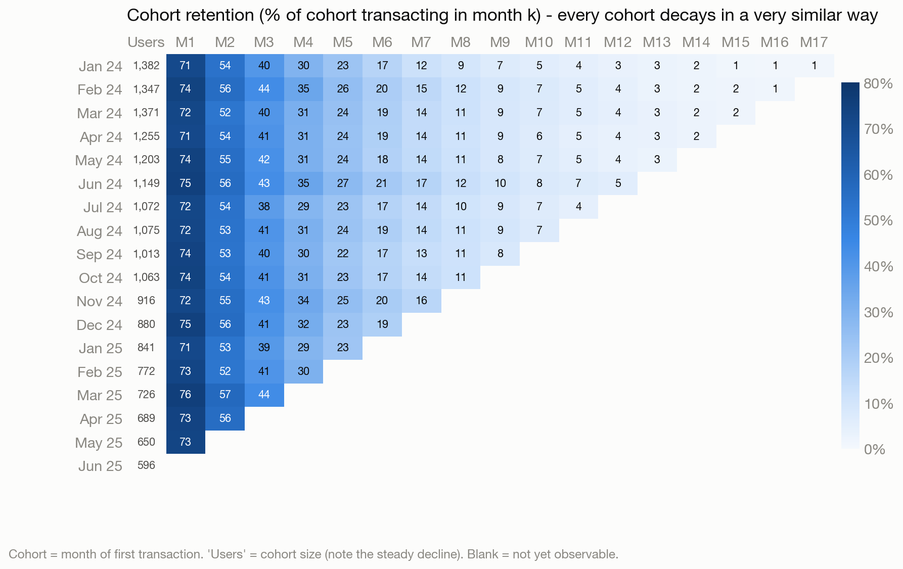

| Weighted average across cohorts | M1 | M2 | M3 | M6 | M9 | M12 |
|---|---|---|---|---|---|---|
| User retention | **73.0%** | 54.3% | 41.2% | 18.5% | 8.6% | **4.1%** |
| GMV retention | 75.8% | 58.5% | 44.7% | 21.7% | 10.8% | 5.0% |

**What the cohorts show**

1. **Retention is stable over time.** Across the 17 cohorts with an observable M1, M1 ranges from 71.1% to 75.6% and M3 from 38.0% to 43.9%. A chi-square test across cohorts finds no real difference (p = 0.51 for M1, 0.20 for M3, 0.16 for M6). No large change is visible over 18 months; that does not prove the cohorts are identical.
2. **There is no plateau.** About 1 in 4 active users stops every month: 27.0% after M0, 25.5% after M1, then about 23.5% a month from M2 to M8.
   - Retention halves roughly every 2.4 months, and only 4% of a cohort is left at M12.
   - The average user is active for 4.0 months (Jan–Jun-24 cohorts).
   - 27% of users never return after their first month, so the first billing cycle is the biggest single leak.
3. **Heavier users survive, but nobody's usage grows.** Transactions per active user rise from 3.0 in M0 to 3.8 at M10+, so GMV retention runs about 3pp above user retention. Yet the *same* users do not use BNPL more over time: users active 9+ months made 3.73 transactions in M0 and 3.59 in M8. Light users simply leave first.

**Anomalies**

4. **No one comes back, at least in this extract.** None of the 14,231 lapsed users who had at least one later month to come back ever transacted again, including users who had a year or more.
5. **Cohorts shrink every month.**
   - New users fell from ~1,370 a month in Q1-24 to 596 in Jun-25 (−56%, or −5.3% a month).
   - With retention stable, this drives MAU (−27% from the Jul–Oct-24 plateau) and GMV (−23% from the Nov-24 peak) (Fig. 1).
   - New cohorts look the same as old ones: average limit 5.05–5.39M VND, first ticket 164–175K VND, and a category mix that moved less than 1pp between the first and last quarter.
   - The decline is a smooth 4.7% a month with only random noise around it. The one exception is Oct-24: 1,063 new users against ~950 expected (z = +3.8). Was there a campaign?
   - **How much of the MAU fall is inflow?** Re-weight only the cohort sizes and keep each cohort's own observed retention. If Nov-24 to Jun-25 had each brought Oct-24's 1,063 new users, Jun-25 MAU would have been about 4,340 instead of 3,019; at the 2024 average inflow, about 4,630. This is an in-sample check, not a forecast.
   - **New users are not getting worse.** In the same 30-day windows, Q1-24 new users made 3.53 purchases and 67.2% were active in days 30–59; Q1-25 new users made 3.65 and 67.9%.
6. **There are no onboarding waves.** 25% of first purchases fall on days 1–3, which looks like month-start onboarding. It is exactly what you get when a user's first-month purchases are spread across the whole month and you look at the earliest one (25.2% expected). Existing users' first purchase of any month clusters the same way (27.0% vs 27.3%). The file has no sign-up dates, so it cannot show when users joined (Bonus G3).

**Hypotheses on the causes, and the data that would test them**

| Pattern | Most likely explanations | Data needed |
|---|---|---|
| No plateau; the biggest drop is right after M0 | (a) Friction at the first statement or repayment (fees, late-payment experience). (b) Usage driven by one-off promotions. | Repayment, DPD and fee data per user; campaign attribution of the first transaction |
| 0% reactivation | (a) Accounts frozen or limits revoked after a missed cycle or inactivity. (b) The extract keeps only each user's first active streak. | Account-status and limit-change logs; whether lapsed users can still transact |
| Shrinking cohorts with unchanged quality | Fewer users reached or approved (eligibility lists, marketing budget, partner traffic) rather than stricter scoring. Stricter scoring would usually shift limits and retention, and neither moved. | Monthly funnel by channel (eligible → invited → approved → first transaction) and marketing spend |

### Q1c. "Users with ≥ N transactions in their first month retain better in M1"

> **Verdict: true in direction, false as a threshold.** Users with more first-month transactions are somewhat more likely to return in M1: 69% at N = 1 against 77–79% at N = 4–8. But no N is special. Splitting at any N from 2 to 8 gives a similar gap (+5.6 to +6.8pp). The raw file's apparent N = 4 is created by 104 suspect rows. Each of the first few transactions adds a little, and the curve then flattens. **If the business wants an onboarding milestone, the 2nd transaction is the most practical one**, because 31% of new users stop at one. Expect a small lift of a few points of M1, and test it before setting a target.

| N (first-month txns) | Users | % of new users | M1 raw | M1 clean |
|---|---|---|---|---|
| 1 | 5,414 | 31% | 68.6% | 68.6% |
| 2 | 3,531 | 20% | 71.6% | 71.6% |
| 3 | 2,843 | 16% | 73.8% | 73.8% |
| **4** | 2,074 | 12% | **82.1%** | **77.1%** |
| 5 | 1,358 | 8% | 78.0% | 78.0% |
| 6 | 849 | 5% | 77.0% | 77.0% |
| 7 | 516 | 3% | 78.1% | 78.1% |
| 8 | 318 | 2% | 79.3% | 79.3% |
| 9+ | 501 | 3% | 78.0% | 78.0% |

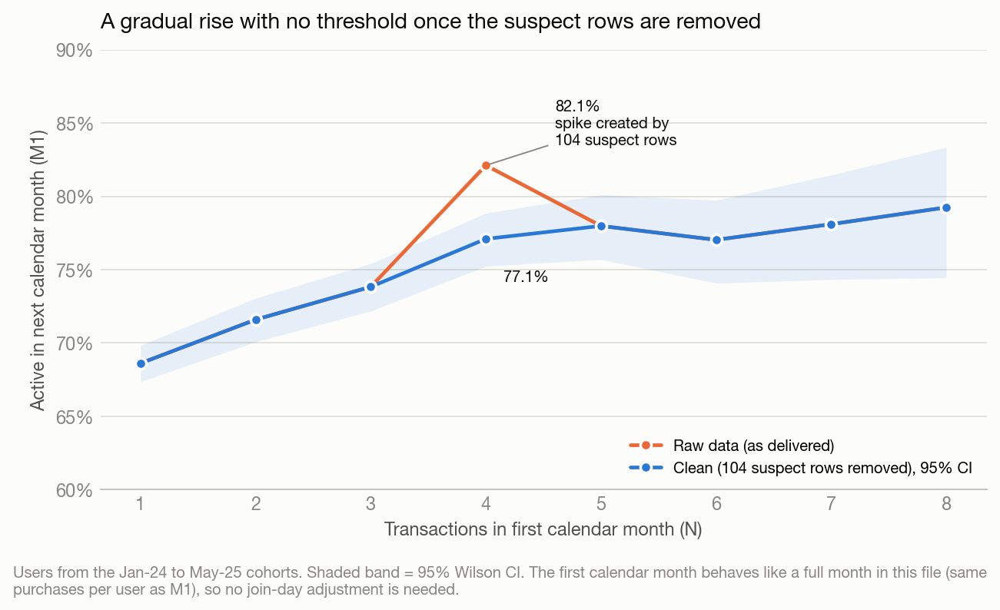

**How I got there**

1. **The raw data seems to confirm N = 4.** ≥4 vs <4 gives 79.5% vs 70.8% (+8.7pp), the best cut of any N.
2. **But the shape is implausible.** Users with *exactly* 4 transactions (82.1%) retain better than users with 5–8 (77.9%, p = 0.0003). Engagement effects do not peak and then fall back like that.
3. **Tracing the spike.**
   - The extra retention comes from 104 rows at the end of the ID sequence, outside their users' otherwise contiguous ID blocks.
   - Each belongs to a user with **exactly 4 transactions, all in M0**, and each lands in **M1**, 4–41 days later. Together they turn 104 of the 475 "4 transactions, no M1" users into retainers.
   - They also contain all 5 package/carrier mismatches in the file and all 5 cases where a balance jumped by more than the purchase.
   - Their balances fall from the previous transaction 57% of the time, against 29% for organic transactions after a similar gap.
   - They are very unlikely to be organic. Data engineering should confirm whether they are test data or a mis-loaded batch. The list is in `outputs/tables/dq_out_of_sequence_rows.csv`.
4. **The clean result.** N = 4 drops to 77.1%, in line with N = 5–8 (77.9%, p = 0.54). ≥4 is still marginally the best cut (+6.8pp), but every N from 2 to 8 gives +5.6 to +6.8pp.
5. **The first month is not a handicap.** One might worry that users who join late in a month have less time to reach 4 purchases. In this file they don't: the first month behaves like a full month (3.23 purchases in M0 vs 3.22 in M1 for the same users), and a late first purchase is simply what a user with few purchases looks like. So the all-user table is already a fair comparison. A regression with cohort and join-week controls puts the first steps at a similar size (1→2: +0.12, 2→3: +0.11, 3→4: +0.18 in log-odds). **No single step dominates.**
6. **Why not equal 30-day windows?** That view shows a +17pp jump from 1 to 2 transactions (46% → 63%), but most of it is mechanical, because activity runs in calendar months and no one returns after a blank month (Bonus G6). For someone whose first purchase falls after the 20th, "one transaction in 30 days" usually means they made no purchase in their second calendar month, i.e. they have already left: only 17% of them are active later, against 58% of those with two transactions. Details are in Appendix B.

**What the data suggests instead**

- **Track the 2nd transaction as a practical milestone, not a magic number.** 31% of new users make only one transaction in their first calendar month. Most second purchases happen within two weeks (Bonus R8), so that is the natural window for a nudge.
- **Frequency matters every month**, not only in month one (Part 2).
- **This is a correlation.** Proving causation needs a randomised 2nd-purchase incentive.
- **Value context.** Measured over the same first 12 months (cohorts Jan–Jul-24), users with 5+ first-month transactions generated 3.7× the GMV of 1-transaction users (4.04M vs 1.08M VND). That is mostly because they buy more often: in that year they are active only about 1.3 months longer (4.6 vs 3.3 months).

> **For the stakeholder:** 104 suspect rows inflate the N = 4 result (+8.7pp instead of +6.8pp) and make exactly 4 look special. A "≥4 transactions" target is no better than 3 or 5. Prefer a 2nd-transaction milestone, which is easier to act on.

---

## Part 2: Deep-dives, Option A (Churn) and Option B (Growth)

The brief asks for one direction; this report covers both, and they reach the same conclusion from opposite sides.
- **Option A (2.1–2.6)** asks who leaves and what would keep them.
- **Option B (2.7–2.10)** asks where new growth can come from.

### Option A: Churn

### 2.1 Definition

**Churned = active in month *t*, with no transaction in month *t+1*.** No one returns after a blank month in this extract, so this is effectively final here. Whether that holds in production needs checking (2.5, action 4).
- **14,981 of 18,000 users (83%) have churned**, and 3,019 were active in Jun-25.
- Monthly churn averages **24.9%**. It was 28.9% in Jan-24, when every user was brand new, and has stayed between 23.5% and 26.3% every month since.
- **Recent drift:** churn edged down from 24.9% (Oct-24) to 23.6% (May-25). About −0.3pp of that comes from a more tenured mix and −1.0pp from lower churn within tenure bands. That is a small improvement, too small to offset the fall in inflow, and one pair of months doesn't prove a trend.

### 2.2 How churners differ from users who stay

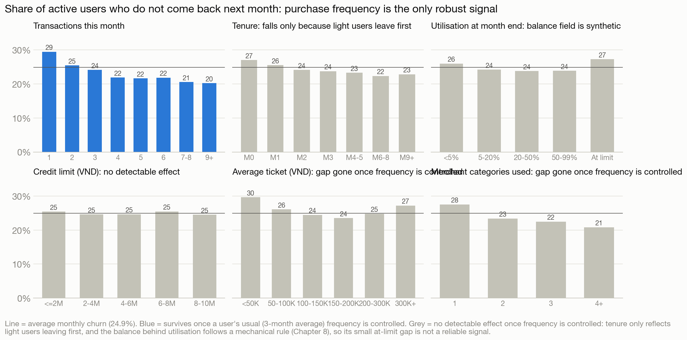

| Signal (share not returning next month) | Higher risk | Lower risk |
|---|---|---|
| Transactions this month | 1 txn: **29.5%** | 4+ txns: **21.5%** |
| Last month, then this month | 1 → 1: **31.6%** | 4+ → 4+: **20.2%** |
| Usual frequency (3-month average) | ≤1 a month: **32.5%** | >6 a month: **19.0%** |
| Tenure (composition only) | M0: 27.0% | M6–8: 22.4% |

**No detectable effect once frequency is controlled** (likelihood-ratio tests, all p > 0.5):
- **Credit-limit size:** 24.5–25.5% churn in every band.
- **Ticket size and number of merchant categories:** their raw gaps disappear, because heavy users naturally spread across more merchants.
- **Recency within the month.**
- **Tenure:** it looks protective only because light users leave first; once a user's usual frequency is known, it adds nothing (p = 0.90).
- **Credit fields:** limits are assigned at random and the balance follows a mechanical rule (Bonus G1), so utilisation and "maxing out" describe the generator, not customers. The small at-limit gap (27.3% vs 24.9%) appears in 2024 only, with no gradient.

**Mid-month silence is a practical trigger.** Take the users who were active last month:
- By day 15, 41% have not transacted. 61% of those make no further purchase that month (vs 25% on average). In this extract that means they are not seen again.
- By day 10 the figures are 52% silent and 48% lost. By day 20 they are 34% and 73%.
- This is a targeting rule, not a forecast, since every churner is silent by definition. It tells CRM who to reach while there is still time.
- **Frequent users can be reached five days earlier.** Users who usually buy more than 5 times a month and are silent by day 10 are already lost 60% of the time. They are 13% of churners but take 29% of churners' GMV with them.

| Profile: the month before leaving vs months followed by more activity | Stayed | Churned |
|---|---|---|
| Avg transactions in the month | 3.32 | 2.98 |
| Share of 1-transaction months | 25.8% | 32.5% |
| Share of 4+ transaction months | 37.6% | 31.0% |
| Avg ticket (VND) | 169K | 170K |
| Merchant categories used | 1.93 | 1.80 |
| Avg credit limit (VND) | 5.25M | 5.22M |

At user level, churned users made fewer transactions from day one: 2.96 vs 3.38 in their first month, and 80.5% vs 91.4% made a 2nd transaction within 30 days.

### 2.3 How predictable is churn, and who to target now

I trained a logistic model on months up to Dec-24 and tested it out-of-time on Jan–May-25. It reaches **AUC 0.56**: the riskiest decile churns at 30.8% vs 19.7% for the safest. Transaction data alone cannot single out churners, so target with simple tiers and the silence trigger, and add repayment, app-activity and campaign data to do better.

Risk is a slowly revealed trait. A user's 3-month average separates churn from 32.5% to 19.0%; this month's count alone only from 27.1% to 20.6%. Given the average, an unusual month adds nothing (log-odds +0.04, 95% CI −0.03 to +0.11). One month's count is a 0.46-reliable read of a user's rate; a 3-month average, 0.72.

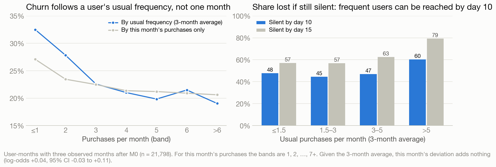

| Tier (Jun-25 active users) | Users | Expected churn next month |
|---|---|---|
| High: 1 transaction in June | 752 | 29.5% |
| Medium: 2–3 transactions | 1,086 | 24.8% |
| Low: 4+ transactions | 1,181 | 21.5% |
| **Total** | **3,019** | **≈ 745 users expected to churn in July** |

These tiers use one month so that every active user can be scored. In production, tier on a 3-month average wherever the history exists.

### 2.4 Why there is no credit lens

The balance field follows a mechanical rule: a 35% random pay-down on each purchase and a cap at the limit (Bonus G1). So churners' balances (6.1B VND left at their last purchase), utilisation and the small at-limit gap say nothing about repayment or credit stress. Risk needs the real statement, repayment and DPD data before any win-back or limit decision.

### 2.5 Recommendations

**The arithmetic first.** We lose ~750 active users a month and gain ~600. Holding 3,000 users needs ~730 new users a month (+23%), or churn under 20% (today it is 24%). The best case in this data, every user with 1–3 transactions churning like a 4+ user, only gets churn to 21%. Retention work helps, but only inflow can reverse the decline.

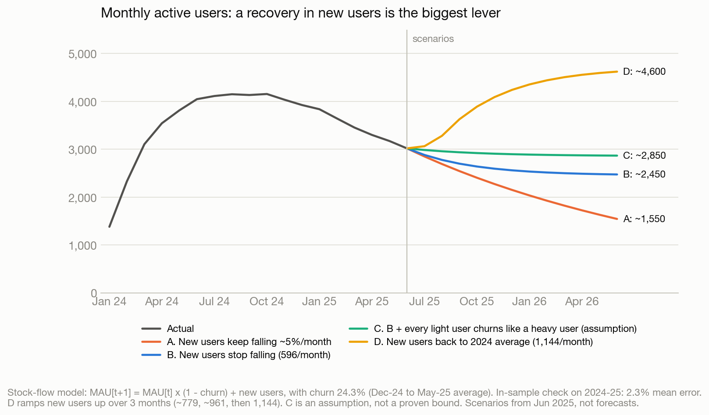

*Illustrations under the stated assumptions, not forecasts. They exclude incentive cost and credit losses, and the real effects must come from holdout tests (2.6).*

| Lever (extra active users by Jun-26 vs. "new users stop falling" ≈ 2,450) | Assumption | Size |
|---|---|---|
| Recover new users to the 2024 average | 596 → 1,144 a month over 3 months | **+2,150** |
| Frequency rewards for users with 1–3 transactions a month | Upper bound: every 1–3 txn user churns like a 4+ user | up to ~+390 |
| Mid-month reminder to silent users | Saves 1 in 10 users who would otherwise be lost | +270 |
| Second-purchase offer for new users | Upper bound: every 1-transaction new user makes a 2nd purchase, worth +3pp M1 each | up to ~+20 |
| Win-back of dormant users *(illustration)* | 1% of ~15,000 come back each month (0% seen so far) | +600 |

| # | Action (proposed owner) | Why | Test / KPI |
|---|---|---|---|
| 1 | **Recover new-user inflow** (Growth + Risk). First reconcile the −56% with the official dashboard, then find which onboarding step shrank: eligible → invited → approved → first transaction. | The decline is inflow-driven, and this is the biggest lever. | New users/month; ~730 a month holds today's base. |
| 2 | **Mid-month reminder** to users who haven't transacted by day ~15, or day ~10 for users who usually buy 5+ times a month (CRM). | 61% of day-15 silent users make no further purchase that month and are not seen again in this extract; frequent users take 29% of churners' GMV. | A/B test with a holdout. KPI: % of silent users who transact by month end, in users and GMV. Watch notification fatigue and cost. |
| 3 | **Frequency rewards for users with 1–3 transactions a month**, segmented on a 3-month average, plus a 2nd-purchase offer for new users (Product + CRM). | Users who usually buy once a month churn at 32.5% vs 19.0% above six. | Randomised test with a holdout. KPIs: churn 2–3 months after the incentive ends (a lasting habit, not a one-month bump); 2nd purchase within 14 days. |
| 4 | **Ask why lapsed users never return, then pilot a win-back** on a small random sample of dormant users with no overdue balance (Risk + CRM). | 0 of 14,231 returned, possibly because of a lock policy. The dormant pool is 5× MAU. | Reactivation and repayment rates in the pilot before scaling. |
| 5 | **Fix the data before setting targets** (BI + Data Eng). | The 104 planted rows created the N = 4 spike; the balance field follows a mechanical rule; purchases pass on a fully used line (Bonus G1–G2). | Permanent exclusion plus ingestion checks (ID contiguity, balance identity, package–carrier pairs). Add the real ledger, approval dates and app events to the churn model. |

**Don'ts:**
- Don't make limit or credit-risk decisions from this file: limits are assigned at random and the balance follows a mechanical rule. Only a randomised limit test on real data can show whether limits drive usage.
- Don't segment users on a single month's purchases; use a 3-month average.
- Prefer a 2nd-transaction milestone to a "≥4 transactions" target.

### 2.6 Test plan: turning the two retention ideas into measured effects

None of the retention numbers above prove that an intervention works: users who buy more may simply like the product more. Two randomised tests with holdouts settle that. The tooling is in `pilot.py`: stratified assignment, an intention-to-treat evaluator that refuses dry-run files, and a historical A/A check whose lift CI covers zero.

**When to trigger the second-purchase nudge: reach vs precision** (users with 60 days of follow-up)

| Trigger: still only 1 purchase on day… | Share of new users | Active days 30–59 | Make a 2nd purchase by day 30 anyway |
|---|---|---|---|
| 7 | 60% | 64% | 70% |
| **14** | **39%** | **60%** | **54%** |
| 21 | 27% | 54% | 33% |

An early trigger reaches more people, but most of them would buy again anyway, so the offer is paid out to users who need no help. A late trigger is more precise but leaves less time to act. **Day 14** is a sensible starting point to test, not a proven optimum. Among day-14-eligible users, activity in days 30–59 ranges from 69% (first purchase on day 1–3) to 42% (after day 20), mostly because the first-purchase day reflects how many purchases a user makes, so randomise **within those bands**.

| | Test A: second-purchase nudge | Test B: mid-month reminder |
|---|---|---|
| Who | New users with exactly 1 purchase by day 14 | Last month's users with no purchase by day 15 |
| Strata | Join-day band (a proxy for first-month purchases) | Last month's frequency band (a 3-month average where available) |
| Primary outcome | Any purchase in days 30–59 after the first | Any purchase in the rest of the month |
| Baseline | 60% | 39% |
| Users per arm (+10pp / +5pp, α 5%, power 80%) | 357 / 1,474 | 387 / 1,528 |
| Eligible per month at today's volumes | ~230 | ~1,240 |
| Time to recruit | **4 / 13 months** | **1 / 3 months** |
| Secondary outcomes | Purchases and GMV in days 30–59 | Activity in the following month; purchases and GMV |
| Guardrails | Incentive cost, repayment/DPD, credit losses, contact fatigue | Same |

**Run Test B first.** It reaches a readable sample in 1–3 months, while Test A needs 4–13 months at current inflow. Both tests can only detect large effects. A more realistic +2pp lift would need about 9,400 users per arm: ~16 months for Test B, and out of reach for Test A at today's inflow. If they show nothing, read that as "no large effect", not "no effect". The arm is fixed per user (hashed user ID), and each user enters a test once.

**Frequency rewards** for users with 1–3 transactions a month should use the same design, stratified on a 2–3 month average frequency, once Test B shows whether contact moves behaviour at all. In both tests, analyse everyone assigned (intention-to-treat), fix the measurement window in advance, and scale only if incremental net contribution is positive: incremental margin − incentive and contact cost − incremental credit losses. Eligibility rules that this file can't support (account status, DPD, consent) must be joined before any real send.

### Option B: Growth

### 2.7 Screening for growth: no existing segment is growing

| Segment (transactions in the month) | Users Jun-24 → Jun-25 | GMV Jun-24 → Jun-25 |
|---|---|---|
| Light (1) | 1,129 → 752 (**-33%**) | 201M → 123M VND (-39%) |
| Medium (2–3) | 1,462 → 1,086 (**-26%**) | 620M → 456M VND (-26%) |
| Heavy (4+) | 1,456 → 1,181 (**-19%**) | 1,414M → 1,182M VND (-16%) |

Every segment is shrinking. Heavy users shrink least, because they survive longest.

None of the other cuts shows a growth pocket either:
- limits are assigned at random and are unrelated to spend;
- ticket size is one random draw for everyone;
- the merchant mix is fixed by construction (34 equal cells) and no first category retains better.

So growth has to be created. Two candidates stand out:

| Candidate | Evidence | Verdict |
|---|---|---|
| **Pattern: new-user inflow** | Falls a steady 4.7% every month (−56% since Q1-24); the only month above the trend is Oct-24 (1,063 vs ~950 expected) | **Strongest potential** (2.8) |
| **Segment: medium users (2–3 txns)** | 36% of the base, 27% of GMV; 23% already reach 4+ in any given month | Best existing segment, but a small lever (2.9) |
| Heavy users (4+) | 65% of GMV, but a user's own frequency doesn't grow with tenure | Protect; reach them early when they go quiet |
| Dormant users (~15K) | Nobody has come back in this extract; the response is unknown | Test only after Risk checks account status |
| Credit limits, ticket size, categories | Limits are a flat random draw, tickets one random draw for everyone, and the merchant mix is fixed by construction | Cannot be evaluated from this file |

### 2.8 Why new-user inflow has the strongest growth potential

1. **It is the binding constraint.** We lose ~750 active users a month and gain ~600. ~730 new users a month would hold the base (2.5). The decline is smooth (4.7% a month with only random noise), which points to a steady change upstream rather than a one-off event. The early-month cluster of first purchases is not evidence of onboarding batches (Bonus G3).
2. **New users stay predictable in value.** A new user brings ~1.85M VND of GMV in their first 7 months. The 3-month GMV per new user stays within 1.12–1.26M across cohorts.
3. **The quality risk from more volume looks small, but it is not proven to be zero.**
   - Across 16 cohorts (689–1,382 new users), cohort size has a weak, non-significant link with M1 (r = -0.28, p = 0.29), first-3-month GMV, 30-day purchases and days 30–59 activity (p = 0.25–0.39). All four lean slightly negative.
   - Taken at face value, returning to Q1-24 volume would cost about **-1.3pp of M1** (95% CI -3.7 to +1.1pp).
   - The test is weak: with 16 cohorts it has only ~20% power to detect r = 0.3. Size also falls with calendar time, and past volumes say nothing about **new channels**. Hence the quality guardrails in 2.10.
4. **In one unit, volume is the largest lever.** The fair comparison is like-for-like: **+100 new users a month adds about as much as the best-case retention programme** (+11.7% vs +11.6% of monthly GMV). Getting back to 2024 inflow is worth +63%. The table expresses the scenarios from 2.5 in GMV (Fig. 11):

| Lever | Extra GMV per month by Jun-26 (% of today's ~1.93B VND) |
|---|---|
| **Recover new users to the 2024 average (+548/month)** | **+1,219M VND (+63%)** |
| +100 new users a month | +226M (+11.7%) |
| Retention upper bound: every 1–3 txn user churns like a 4+ user | +223M (+11.6%) |
| Upgrade 10% of medium users to 4 transactions a month | +28M (+1.5%) |
| Upgrade 10% of light users to 2 transactions a month | +13M (+0.7%) |

All rows are illustrations under the stated assumptions, before incentive cost and credit losses, priced at the recent ~568K VND GMV per active user. A win-back of 1% of dormant users a month would add ~338M, but the response is unknown (nobody has returned in this extract), so it is not ranked.

Monthly GMV by Jun-26 would be roughly:
- **~0.88B** if new users keep falling;
- **~1.40B** if they hold flat;
- **~2.62B** at 2024 inflow.

These hold GMV per user constant. Because GMV per user rises as the base ages (Bonus R5), the falling path is somewhat understated and the 2024-inflow path somewhat overstated.

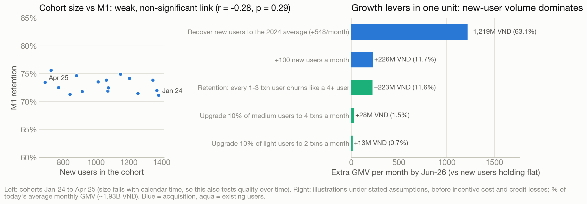

### 2.9 The best existing segment: medium users, a small lever

Users with 2–3 transactions a month are 36% of the base and 27% of GMV.
- Each one who moves up to 4 transactions adds ~260K VND of GMV a month, and churns less (21.5% vs 24.8%).
- 23% of them reach 4+ in any given month on their own, so a programme pays for many moves it didn't cause.
- Moving an extra 10% adds ~1.5% of monthly GMV.
- Within the 1–3 transaction group targeted for retention in 2.5, the 2–3 subgroup is the cheapest GMV step up.
- Rank users on a 3-month average; a single month mislabels many of them.
- Heavy users are the segment to protect: Dec-24 users who usually bought more than 5 times a month spent 3.0M VND each over the next six months, against 0.71M for those averaging 1.5 or fewer.

### 2.10 What to do for growth

| # | Action (proposed owner) | Detail | KPI / guardrail |
|---|---|---|---|
| 1 | **Restore new-user inflow** (Growth + Risk; the same target as 2.5 #1) | ≥730 first-time users a month stops the decline; ~1,150 returns to 2024 levels. Trace eligible → invited → approved → first purchase by channel to find the step that shrank, and ask what happened in Oct-24 | First-time users per month; funnel conversion by step and channel |
| 2 | **Budget on unit value** (Finance) | Gross revenue per new user ≈ take rate × 1.85M VND over 7 months, before funding cost and credit losses. Finance turns that into a CAC ceiling | CAC vs ceiling |
| 3 | **Guard quality as volume returns** (BI + Risk) | Each new cohort should stay near today's levels: calendar M1 ~71–76%, ~3.5–3.7 purchases in the first 30 days, DPD within appetite. New channels have no track record, so watch them first | Stop scaling any channel that falls below |
| 4 | **Measure channel incrementality** (Growth) | Use geo or time holdouts instead of attributed sign-ups | Incremental first-time users per VND |
| 5 | **Medium-segment frequency test** (Product + CRM) | Same design as Tests A/B in 2.6: intention-to-treat, a holdout, stratified on a 2–3 month average frequency. Run it after Test B | Incremental share of 4+ users; incremental GMV |

---

<!-- one-pager:start -->
## Part 3: One page for the Business Lead

*(Formatted, printable version: `one_pager.html`. Generated from the same content.)*

**BNPL is shrinking because fewer new users arrive, not because users leave faster**

Users leave at about the same pace as before, 1 in 4 a month; new users fell 56% since early 2024. Retention alone would need churn below 20% for everyone, the level of our most frequent buyers, so bringing new users back is the bigger lever.

| Active users, Jun 2025 | New users, Jun 2025 | Active users lost each month | Still active after 12 months | Payment volume, Jun 2025 |
|---|---|---|---|---|
| **3,019**: −27% from Jul–Oct 2024 (~4,150) | **596**: −56% from early 2024 (~1,370 a month) | **1 in 4**: 23.5–26.3% every month since Feb 2024 | **4%**: none who stopped came back in this data | **1.76B VND**: −23% from the Nov 2024 peak |

### What is happening

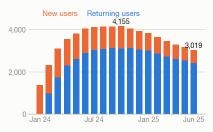

**Active users fell because new users fell.** New users a month went from ~1,370 in early 2024 to 596 in Jun 2025, about 5% fewer every month. From May to Jun 2025 we lost ~750 active users and gained ~600, so the base shrinks.

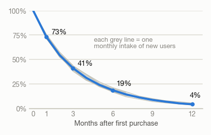

**Every intake of new users loses about 1 in 4 a month.** 73% are still active after 1 month, 4% after 12. Every monthly intake since Jan 2024 follows a very similar curve, and nobody who stopped came back.

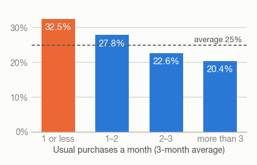

**Users who rarely buy leave most.** Share who stop the next month, by usual purchases a month: 32.5% for one or less, about 20% above three. Limit, purchase size and category add nothing once frequency is known. 6 in 10 of last month's users still silent on the 15th buy nothing more that month.

### What it means

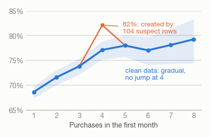

**There is no magic “4 purchases in the first month”.** Share active in month 2, by purchases in month 1. It rises gradually; the jump at 4 came from 104 suspect rows. A practical goal is a second purchase: 31% of new users stop at one.

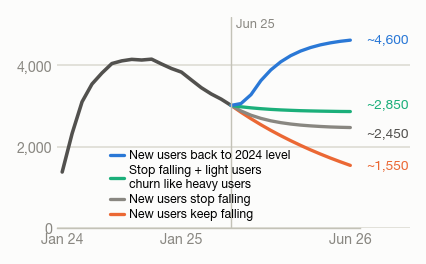

**New users are the biggest lever.** Active users to Jun 2026 under four assumptions. If light users churned like heavy users, the line only flattens; 2024-level inflow turns it up.

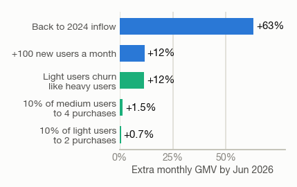

**In payment volume, new users matter most.** 100 extra new users a month add as much as light users churning like heavy users (+12% each). Moving 10% of medium users to 4 purchases adds 1.5%.

### What we should do next

| # | Action | Owner | Why it matters |
|---|---|---|---|
| 1 | **Find where new users dropped and fix it**: reach, approval or first use? ~730 a month holds the Jun 2025 base. | Growth + Risk | Biggest lever: ~2,150 more active users in a year at the 2024 level vs flat inflow. |
| 2 | **Remind users who haven't used BNPL by mid-month**, by day 10 for frequent users (test on eligible users first). | CRM | If it saves 1 in 10 would-be leavers: ~270 more active users in a year. Answer in 1–3 months. |
| 3 | **Help new users make a second purchase, then reward occasional users for using BNPL more often** (test first; slower to read). | Product + CRM | Occasional users leave most. ~390 active users in a year if they churned like heavy users. |
| 4 | **Give Finance what a new user brings**: ~1.85M VND of payments in their first 7 months. | Finance + Growth | Finance sets a cost-per-user limit after revenue share, funding and credit losses. |
| 5 | **Ask Risk why people who stop never come back** (account lock?) before any win-back offer. | Risk + CRM | About 15,000 former users; the response is unknown. |

**Also worth knowing**

- **Heavy users carry the business:** 38% of active users, 65% of payment volume.
- **Frequent users can be reached earlier:** those who usually buy 5+ times a month and are silent on day 10 are already 60% lost; they made 29% of the last-month payments of users who leave.
- **The credit fields can't guide credit decisions:** limits look randomly assigned and balances follow a mechanical rule. Get the real repayment data first.
- **The data needs checking:** it covers 18 months, not 6; 104 suspect rows created the “4 purchases” myth; several fields look simulated. Confirm the new-user drop against official numbers.

**Don't** set limits or risk rules from this file, and don't set a “4 purchases in the first month” target.

**Decision needed:** approve a two-week review of where new users dropped, and the mid-month reminder test (answer in 1–3 months) once eligibility and consent are confirmed.

*Active user = at least one BNPL purchase that month; new user = first purchase seen in the data. Occasional / medium / heavy = 1 / 2–3 / 4+ purchases a month. Lines to Jun 2026 are scenarios from Jun 2025, not forecasts; sizes are assumptions to test, before incentive cost and credit losses. GMV is not revenue. 104 suspect rows excluded. Full analysis: report_visual.html.*

<!-- one-pager:end -->
---

## Bonus: what is real in this file, and what its generator explains

Two independent review agents re-examined all 8 columns and every earlier Bonus finding. I re-checked their key claims and recomputed the headline numbers in `analysis.py` (section 7e, keys `f_…` and `b_…`). Full reports and scripts are in `eda/data_forensics/` and `eda/behaviour/`. "Light / medium / heavy" means 1 / 2–3 / 4+ transactions in a month.

**The main conclusion:** this extract was generated by a few simple rules.
- Some patterns are real and useful (part R).
- Others are the rules showing through (part G).

Knowing which is which tells the business what to act on, and the data owner what to fix.

### R. Real in this file, and useful

**R1. Churn risk is a stable trait of the user.**
- A user's 3-month average frequency separates churn from 32.5% (≤1 a month) to 19.0% (>6). This month's count alone only separates it from 27.1% to 20.6%.
- Given the average, an unusual month adds nothing: log-odds +0.04, 95% CI −0.03 to +0.11.
- One month's count is a 0.46-reliable read of a user's rate; a 3-month average is 0.72.
- *Takeaway: segment, tier and target on a 3-month average, and judge frequency programmes on churn after the incentive ends.*

**R2. Tenure buys nothing, and no loyal core forms.**
- Within a user, frequency is flat over tenure: −0.001 purchases a month (±0.007).
- Once usual frequency is known, tenure doesn't lower churn (p = 0.90).
- A shifted-beta-geometric model fits retention far better than constant churn (likelihood ratio 67). It still implies propensities averaging 26% a month with a narrow spread (SD 7pp): only 0.2% of users sit below 10% a month.
- *Takeaway: a loyal base will not emerge by waiting; reward frequency, not tenure.*

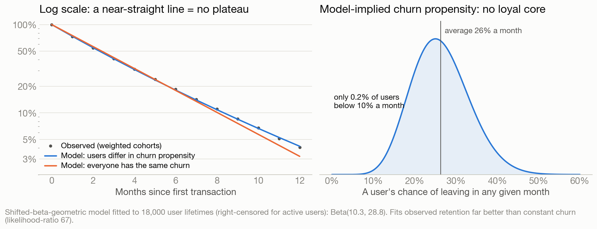

**R3. Heavy users carry the business.**
- Heavy users are 38% of the base but 65% of GMV. Over the last 6 months they spent ~980K VND a month, against ~420K for medium users and ~170K for light users.
- Over their whole observed history, the top 10% of users generate 39% of GMV and the top 20% generate 58%.
- Dec-24 users who usually bought more than 5 times a month spent 3.0M VND each over the next six months, against 0.71M for those averaging 1.5 or fewer.
- *Takeaway: protect heavy users first, and reach them by day 10 when they go quiet (2.2).*

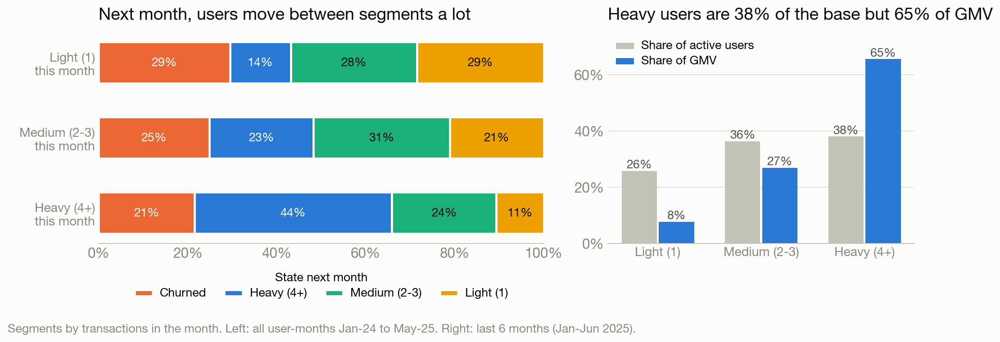

**R4. Value is how often × how long.**
- Ticket size is not a user trait: a user's average ticket varies no more than chance (ICC ≈ 0, p = 0.65). Lifetime GMV is essentially purchases × ~170K VND.
- A new user generates ~1.85M VND of GMV in their first 7 months (13,726 users observed for M0–M6) and 2.14M over M0–M11. The survival model puts lifetime GMV at ~2.29M VND.
- The 3-month GMV per new user stays within 1.12–1.26M VND across cohorts.
- *Takeaway: there is no "big spender" segment, so RFM collapses to frequency and recency. Budget acquisition on the fixed-window 1.85M (2.10).*

**R5. The base is getting heavier as it shrinks.**
- Heavy users went from 36% of MAU (Jun-24) to 39% (Jun-25).
- Transactions per active user rose 6% since Oct-24, because light users leave first. Individual users are not getting heavier (R2).
- *Takeaway: never show GMV per active user without MAU and new users.*

**R6. Monthly frequency is noisy, and users stop abruptly.**
- 14% of light users are heavy the next month, 11% of heavy users drop to light, and only 44% of heavy users stay heavy.
- Users transacting at less than half their own usual rate churn at 23%, the same as users near their usual rate (23–24%).
- *Takeaway: there is no slowing-down phase to detect; act on silence within the month (2.2).*

**R7. Category choice has no memory.**
- The next purchase is in the same package 52.5% of the time, against 52.6% expected from the user's own mix.
- Users do have a home category (median 67% of purchases).
- No category is a gateway or an exit:
  - the first category doesn't change lifetime (3.8–4.2 months);
  - the first merchant group shows no M1 difference across 21 groups (p = 0.62).
- The breadth effect is borderline: users with 2+ merchant groups in their first 30 days are 6.9pp more active in days 30–59, but only 2.0pp within the same purchase-count band (p ≈ 0.05).
- *Takeaway: default offers to the home category, and judge cross-sell only on incremental GMV.*

**R8. Second purchases come early.**
- Of all new users (60-day follow-up), 40% make a second purchase within 7 days, 61% within 14 and 82% within 30, with a median gap of 8 days.
- Purchase days are spread at random within the month, so this is a window, not a behavioural moment.
- *Takeaway: the second week is a sensible window to test a nudge (2.6).*

**R9. Inflow fell smoothly, with one exception.**
- New users fall 4.7% a month with only random noise around the trend (dispersion 1.01 without Oct-24).
- Oct-24 is the one month above it: 1,063 new users against ~950 expected (z = +3.8).
- *Takeaway: ask Growth what happened in Oct-24; it may show what works.*

### G. Explained by how the file was generated (for the data owner)

**G1. The balance field follows a rule.**
- Every clean row fits one of three rules:
  - balance = previous + purchase (63.7%);
  - balance = the limit, when that sum would exceed it (1.3%);
  - a random pay-down (35.0%).
- The pay-down ignores time since the last purchase (34.9% same day vs 35.2% after 30+ days) and the previous pay-down. The share it keeps is a flat 0–70% draw.
- *Takeaway: utilisation, "maxed-out" or "credit-hungry" users, inferred repayment and churners' balances describe the generator. Get the real ledger (statements, repayments, DPD) before any credit decision.*

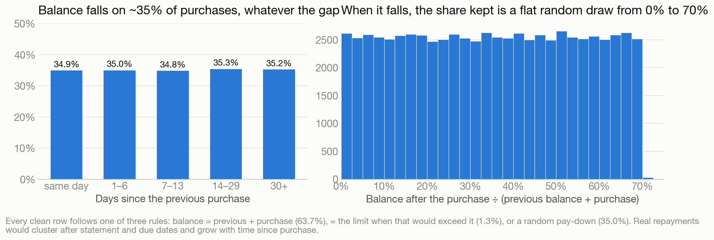

**G2. There is a per-purchase cap, but no available-credit check.**
- No purchase exceeds 60% of the limit, and 698 sit exactly on it.
- Yet 4,032 purchases went through above the remaining headroom, 2,394 of them on a fully used line.
- *Takeaway: ask whether these are production rules (then it is a credit-control gap) or simulation rules.*

**G3. There are no onboarding waves and no partial first month.**
- 25.4% of first purchases fall on days 1–3, against 25.2% expected if a user's first-month purchases were spread over the whole month.
- Existing users' first purchase of any month clusters the same way (27.0% vs 27.3%).
- The same 9,103 users make 3.23 purchases in M0, 3.22 in M1 and 3.23 in M2.
- A late first purchase is what a user with few purchases looks like. Users whose first purchase falls on day 1–3 average 4.3 first-month purchases, against 3.0 overall.
- *Takeaway: get true approval dates, and don't plan month-start campaigns on this pattern.*

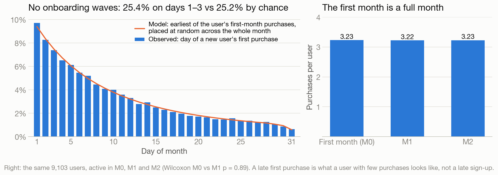

**G4. The 104 suspect rows were constructed.**
- Each row copies its balance from one of the user's own earlier rows (104 of 104).
- Package and carrier are drawn separately from the user's history, which explains all 5 hierarchy breaks.
- Each row lands in M1, turning a random 22% of the "4 purchases, no M1" users into retainers.
- *Takeaway: exclude them permanently, and add ID-contiguity, balance-identity and package–carrier checks to ingestion.*

**G5. Amounts, limits and merchants are random draws.**
- **Amounts** are one random draw for everyone:
  - median ~133K VND, floored at 20K (787 rows at 20K vs 160 at 21K) and capped at 60% of the limit;
  - average ticket is 165–172K VND in every merchant group.
- **Limits** cover all 95 levels from 0.5M to 9.9M, with 161–245 users each. They never change, and they are unrelated to frequency (ρ = 0.006).
- **Merchant volume** is split evenly across 34 package×carrier cells (5,411–6,495 rows each). So "two packages carry 61% of GMV" only reflects how many merchants they list.
- "No buy-big-and-leave" holds by construction: a purchase worth ≥50% of the limit just means a small limit.
- *Takeaway: don't rank categories, price tickets or set limits from this file.*

**G6. There is no calendar rhythm.**
- Weekday volume varies by ±2%, and weekends carry 28.5% of transactions against 28.6% of days.
- Purchase days are uniform within the month, and no holiday is significant: Tết, 30/4, 11/11 and 12/12 all sit within normal variation.
- Daily counts vary no more than pure counting noise (median within-month CV 5.0%).
- Churn does not depend on the day of the last purchase (p = 0.16).
- *Takeaway: calibrate reminder timing on production data.*

**G7. Field-level notes.**
- `transaction_id` was assigned after sorting by user and date, so it is a row number, not a system ID.
- `Other services` behaves like a separate merchant from `Other Services`.
- `total_outstanding` is below the purchase amount on 35% of first transactions. This is the same random pay-down that hits 35% of all purchases.

### What this review changed in the earlier findings
- **Dropped:**
  - the "128 credit-hungry users" (the limit and one month's purchases alone predict the flag);
  - "users use ~7% of their limit";
  - "maxing out the line adds churn" (seen in 2024 only, with no gradient);
  - "new users arrive in monthly onboarding waves".
- **Reframed:**
  - inferred repayment cannot predict churn, by construction;
  - the Q1c "joined on day 1–3" subgroup is selected on first-month purchases, so it is a robustness check, not a fairer comparison;
  - tenure's link to churn is composition.
- **Corrected in the data log:** the "duplicate" pair and the same-day pairs are consistent with chance once the 60% cap is accounted for.
- **Strengthened:** the 104 rows were constructed, so their exclusion is permanent.

---

## Appendix

### A. Data-quality log

| Check | Result | Treatment |
|---|---|---|
| Size | 204,694 transactions · 18,000 users (IDs 100000–117999) · no nulls · no duplicate IDs | n/a |
| Period | 2024-01-01 → 2025-06-30 = 18 months (the brief says 6) | Used all 18 months |
| Out-of-sequence rows | 104 rows (TXN00204591–TXN00204694) outside their users' contiguous ID blocks, built from each user's own earlier rows (balance copied 104/104); all of them affect the Q1c pattern (see Q1c) | Excluded permanently |
| Package → carrier hierarchy | 5 violations, all inside the 104 | Removed with them |
| Balance rises by more than the purchase | 5 rows, all inside the 104 | Removed with them |
| Balance field | Every row fits balance = previous + purchase (63.7%), = the limit (1.3%) or a random 0–70% pay-down (35.0%); 2,645 rows (671 users) sit exactly at the limit | Kept; not used for credit conclusions (Bonus G1) |
| Purchase amount vs limit | No purchase above 60% of the limit (698 exactly at it); 4,032 purchases above the available headroom, 2,394 on a fully used line | Flagged to the data owner (Bonus G2) |
| Exact duplicate | 1 pair (TXN00016242/43): both 300K, exactly 60% of a 500K limit, with the balance at the cap, so probably chance | Kept (immaterial) |
| Same user + day + amount | 61 pairs; consistent with chance once the 60% cap is accounted for (~54 expected, p = 0.19) | Kept |
| `Other services` vs `Other Services` | 5,727 rows, all Channel Partner; behaves like a separate merchant (users mix the two labels no more than distinct merchants) | Merged only for category counts (no conclusion depends on it); ask the data owner |
| `total_outstanding` on the first transaction | Below the purchase amount for 35% of users: the same random pay-down that hits 35% of all purchases | Not used for credit conclusions |
| `total_limit` | Never changes for any user | Static attribute |

### A2. Delivered file vs 104 rows quarantined

| Metric | Delivered file | Quarantined (used in this report) |
|---|---|---|
| Transactions | 204,694 | 204,590 |
| M1 retention (weighted) | 73.6% | 73.0% |
| MAU peak / Jun-25 | 4,162 / 3,022 | 4,155 / 3,019 |
| Monthly churn | 24.9% | 24.9% |
| Churn after a 1-txn / 4+ month | 29.9% / 21.0% | 29.5% / 21.5% |
| M1 at exactly N = 4 | **82.1%** | **77.1%** |
| Gap ≥4 vs <4 | +8.7pp | +6.8pp |
| Users who returned after a blank month | 0 | 0 |

Only Q1c's exact-4 cell depends on the decision. Source: `m1_delivered_vs_quarantined.csv`.

### B. Q1c robustness

- **Join timing.** Within users who joined on days 1–15 and within those who joined on days 16–31, the pattern is the same (`q1c_by_join_timing.csv`).
- **Equal 30-day windows** (users with ≥60 days of follow-up): 45.6%, 62.8%, 69.1%, 75.2%, 78.5%, 79.9%, 83.1% and 85.3% for 1–8 transactions (`q1c_rolling_30d_definition.csv`). Split by join day, the 1-transaction group goes from 65% active (joined day 1–3) to 17% (joined day 21–31). The 1→2 jump is largely a month-boundary effect (`q1c_rolling_30d_by_join_day.csv`), so I don't use it for sizing.
- **First purchase on day 1–3** (n = 4,422): 66.4%, 74.3%, 74.1%, 77.6%, 78.4% and 79.9% for N = 1–6+ (`q1c_full_first_month.csv`). The same gradual rise, but this group is selected on first-month purchases (mean 4.3 vs 3.0), so it is a robustness check, not a fairer comparison.
- **Logistic regression with cohort and join-week controls.** The coefficient for N = 4 (0.40) sits inside the range for N = 5–8 (0.40–0.49).
- **Post-hoc tests.** The 3-vs-4 difference in the clean data (p = 0.01) is a post-hoc comparison with no multiplicity correction, so I don't rely on it.

### C. Churn model details

- **Data:** logistic regression on 60,145 user-months.
- **Features:** transactions this month and last month, tenure, merchant categories, ticket size, utilisation, an at-the-limit flag, log limit and the day of the last transaction.
- **Frequency:** odds ratios vs 1 transaction are 0.85 (2), 0.80 (3) and 0.71 (4+).
- **At the limit:** +0.24 log-odds (p = 0.02), but present in 2024 only, with no gradient in utilisation, on a balance field that follows a mechanical rule, so it is not treated as a signal.
- **Usual frequency:** a user's 3-month average predicts churn better than this month's count. Given the average, this month's deviation adds nothing (log-odds +0.04, 95% CI −0.03 to +0.11), and neither does tenure (p = 0.90).
- **Joint likelihood-ratio tests:** categories, ticket, utilisation, limit and recency together p = 0.73 (separately: categories 0.51, ticket 0.64, utilisation/limit/recency 0.53). Adding the at-limit flag to that set gives p = 0.19.
- **Fit:** pseudo-R² is below 0.01, so read the results as "no detectable effect", not "no effect".
- **Out-of-time validation:** AUC 0.56; the top 20% of scores capture 25% of churners.

### D. Scenario model and sizing

- **Model:** MAU[t+1] = MAU[t] × (1 − churn) + new users, with churn at the Dec-24 to May-25 average of 24.3%.
- **In-sample check:** with no reactivation the model is an accounting identity, so the 2024–25 in-sample error (2.3%) only shows that churn has been stable.
- **Simplification:** using one churn rate for all tenures (new users churn at 27%) makes the projections 1–2% optimistic (a tenure-aware rerun gives −1.1% for B and −1.7% for D).
- **Scenario D:** ramps new users from 779 to 961 to 1,144.
- **Sizing:** all lever sizes are extra active users in Jun-26 against scenario B (`p2_action_sizing.csv`).

### E. Assumptions & limitations

- **First transaction = activation.** The Jan-24 cohort (1,382) is the same size as Feb (1,347) and Mar (1,371) and retains the same way, so there is no sign that pre-existing users were swept in.
- **Right-censoring:** averages use only observable cohort-months, and the Jun-25 cohort is excluded from M1.
- **GMV is not revenue.** The file has no fee, interest or loss data.
- **All findings are observational.** Every recommendation comes with a test.
- **Sample or full base?** The extract may be a sample: exactly 18,000 users, with IDs unrelated to join date. Confirm cohort sizes against official numbers.
- **Simulated extract.** Balances, amounts, limits, merchant mix and timing follow simple generating rules (Bonus G). Conclusions about those fields describe the generator; the decisions rest on inflow, retention and frequency.

### F. Files

| File | What it is |
|---|---|
| `REPORT.md` / `report_by_question.html` | This write-up, question by question (the HTML is self-contained) |
| `report.html` | The same analysis told as one story (main deliverable; source `report_src.html`) |
| `one_pager.html` | Part 3, printable on one A4 page |
| `analysis.py` / `build_html.py` / `pilot.py` | Full pipeline / HTML builder / pilot assignment and evaluation |
| `outputs/key_numbers.json` | Every number quoted in this report |
| `outputs/tables/*.csv` | Cohort matrices, Q1c, churn, sizing, scenarios, data-quality log, extended findings (`x*`) |
| `outputs/charts/*.png` | Figures 1–13 and the one-pager charts (`op*`) |
| `eda/data_forensics/`, `eda/behaviour/` | The two deep-EDA reviews: report, script and outputs each |
