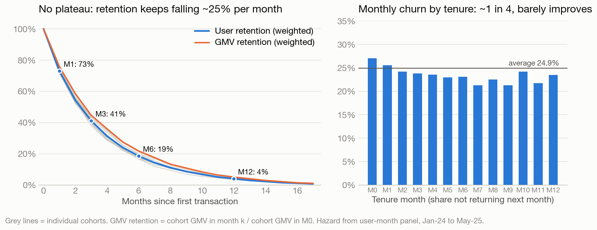

# BNPL retention: the gap is new-user inflow

*ZaloPay Credit Enablement · Transactions from Jan 2024 to Jun 2025 · Main analysis excludes 104 anomalous rows*

> **Decision:** Check where first-time users dropped in the acquisition funnel, then run a controlled mid-month reminder test. Retention work can slow the decline; restoring new-user inflow has the largest potential to reverse it.

| Jun 2025 active users | Jun 2025 first-time users | Monthly lapse |
|---:|---:|---:|
| **3,019** (−27% from the 2024 peak) | **596** (−56% vs Q1 2024 monthly average) | **24.9%** on average |

## Data and decision rules

The brief says six months; the file contains **18 months, 204,694 transactions and 18,000 users**. I use all observed months; “new user” means first **observed BNPL purchase**, since signup dates are unavailable. The main analysis quarantines 104 structurally anomalous rows (IDs `TXN00204591–TXN00204694`); results on the delivered file are checked separately. They materially change only the apparent first-month **N = 4** threshold. Their origin needs confirmation from Data Engineering.

The balance, limit and amount fields exhibit mechanical patterns, so this report makes **no credit-risk or limit recommendation** from them. Transactional activity is an observed behaviour, not evidence of repayment quality. This extract may also be a sample: validate the inflow trend against the official dashboard before acting.

## Q1a · What counts as retention?

**A user is retained in M*k* when they make at least one BNPL transaction in the *k*th calendar month after their first-transaction month (M0).** Divide retained users by the original cohort size. A transaction is the value event available in this dataset; a month matches BNPL's billing and business reporting cycle. First purchase is the only observable activation date. Track cohort GMV alongside users, but do not use spend as the retention threshold. Later cohort months include only cohorts with enough follow-up.

## Q1b · What do the cohorts show?

| Weighted cohort average | M1 | M3 | M6 | M12 |
|---|---:|---:|---:|---:|
| Users retained | **73.0%** | **41.2%** | **18.5%** | **4.1%** |
| GMV / M0 GMV | 75.8% | 44.7% | 21.7% | 5.0% |

**The curve is stable, but has no plateau.** Across 17 cohorts with observable M1, retention spans 71.1–75.6%; roughly one quarter of active users leave each month. The first cycle loses 27%; repayment friction or one-off promotions are plausible causes to check in ledger and campaign data. None of **14,231** users who lapsed with time to return did so **in this extract**. That could reflect account restrictions or how the extract was constructed; check account status and reactivation eligibility before designing win-back.

**The base shrank as inflow fell.** Active users were about 4,150 in Jul–Oct 2024 and 3,019 in Jun 2025. First-time users fell from about 1,367/month in Q1 2024 to 596 in Jun 2025 (−56%), while monthly lapse stayed broadly between 23.5% and 26.3% after the first month. New cohorts show similar early activity, so the visible decline points upstream. Hypotheses: fewer eligible users, invitations, approvals or partner referrals. Check that funnel by month and channel; the transaction file cannot identify which step changed.

## Q1c · Is there a first-month transaction threshold N?

**Higher first-month frequency correlates with M1 retention, but there is no convincing threshold.** On the cleaned data, M1 rises from 68.6% for exactly one transaction to about 77–79% for four to eight. Splitting at any practical N from 2 to 8 yields a similar 5.6–6.8 percentage-point gap.

| First-month transactions | Share of eligible new users | M1, main analysis | M1, delivered file |
|---|---:|---:|---:|
| 1 | 31% | 68.6% | 68.6% |
| 2 | 20% | 71.6% | 71.6% |
| 3 | 16% | 73.8% | 73.8% |
| **4** | **12%** | **77.1%** | **82.1%** |
| 5–8 | 17% | 77.9% | 77.9% |

All 104 anomalous rows fall in M1 for users with exactly four M0 transactions. Keeping them makes four look special; excluding them removes the spike. **Use the second purchase as a practical onboarding milestone**, because 31% stop after one transaction. Its observed association is not a causal effect: test a nudge before setting an incentive or target.

## Part 2 · Option A: churn

Here **lapse** means an active user in month *t* makes no transaction in *t+1*. The last month has no observable next-month outcome. This is a purchase-based signal, not proof of account closure. Average monthly lapse is 24.9%.

| Signal | Higher lapse | Lower lapse | Readout |
|---|---:|---:|---|
| This month's frequency | 1 purchase: **29.5%** | 4+: **21.5%** | Useful first cut |
| Usual frequency, 3-month average | ≤1/month: **32.5%** | >6/month: **19.0%** | Better for targeting |

The difference is mainly **habitual frequency**, not one unusual month. Tenure, ticket, merchant breadth and limit show little additional signal after frequency is considered. An out-of-time transaction-only model reaches **AUC 0.56**, so individual predictions are weak; repayment, app activity and campaign exposure would be needed to investigate other drivers.

**Actionable timing:** among last month's active users, 41% have made no purchase by day 15; 61% of this silent group make no purchase for the rest of that month. This is a *within-month targeting rule*, not a forecast of next-month churn. For users who usually buy more than five times/month, day-10 silence has similar precision (60%). Use a three-month frequency band and account eligibility checks before contact.

### Recommended tests and decision

1. **Priority: restore inflow.** Trace eligible → invited → approved → first purchase by channel. At the recent lapse rate, about **730** new users/month would hold the ~3,000-user base, versus 596 in Jun 2025. Check cohort M1, first-30-day activity and repayment quality as volume returns.
2. **Test a reminder.** Randomise last month's users who are silent by day 15 to reminder or holdout, stratified by usual frequency. Primary outcome: any purchase by month-end; follow next-month activity and net contribution after contact cost and credit losses. The historical baseline is ~39%; about **387 users/arm** are needed to detect +10 percentage points, or **1,528/arm** for +5 points. At current eligibility, recruitment takes about **1 or 3 months**, respectively.
3. **Then test a second-purchase nudge** for new users still at one purchase on day 14. Randomise within first-purchase-day bands. Primary outcome: purchase in days 30–59 after first use. At current inflow, even a +10-point test needs about **4 months** of recruitment; do not promise a quick result.

The frequency gap is observational; none of these interventions has a measured lift yet. Scale only if the holdout shows positive **incremental net contribution**, with repayment and contact-fatigue guardrails. Do not use the synthetic balance field for credit decisions.

## Part 3 · Brief for the Business Lead

| What is happening | Why it matters | What to do next |
|---|---|---|
| MAU is **3,019**, down **27%** from the 2024 peak. | New users fell **56%**; monthly lapse stayed near **25%**. About 750 leave and 600 arrive each month. | **First:** reconcile the drop with the official funnel and find the failing step. |
| Cohorts retain **73%** at M1 and only **4%** at M12. | A second purchase correlates with better retention; a “four purchases” target is distorted by 104 suspect rows. | **Next:** test a mid-month reminder; test the second-purchase nudge after that. |

**Decision requested:** a two-week acquisition-funnel review and approval for a holdout-based reminder pilot. Evaluate incremental activity **and** repayment quality before scaling.

## Bonus · Two things worth knowing

- **No observed reactivation:** 0 of 14,231 users who lapsed and had time to return did so. Confirm whether accounts remain eligible; otherwise win-back targeting is premature.
- **Concentrated value:** users with 4+ purchases/month are 38% of active user-months but 65% of GMV. Protect the experience for frequent users; GMV is payment volume, not revenue.

*Source and audit trail: [full question-by-question analysis](REPORT.md), [calculation tables](outputs/tables/) and [key numbers](outputs/key_numbers.json). Scenarios and pilot sample sizes are planning estimates, not measured intervention effects.*
