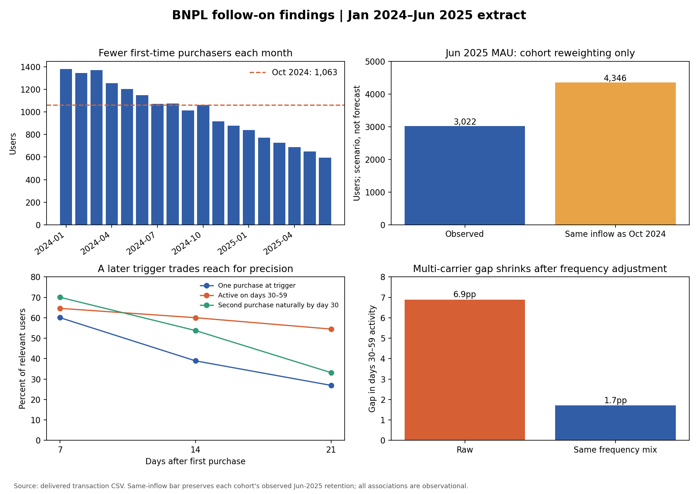

# Phân tích mở rộng: nhiều góc nhìn để ra quyết định

Đây là phần mở rộng của [bài trả lời đề test](REPORT.md). Toàn bộ số bên dưới được tạo bởi [next_steps.py](next_steps.py) từ `data.csv`; [summary.json](outputs/next_steps/summary.json) và các CSV trong `outputs/next_steps/` là bảng kiểm tra. Dùng dữ liệu gốc làm chính. Các kết luận kinh doanh vẫn cần đối chiếu với hệ thống sản phẩm vì extract có đúng 18.000 user và không có user quay lại sau một tháng trống.

## 1. Động lực tăng trưởng: lượng người mới là đòn bẩy lớn nhất

| Finding | Bằng chứng | Quyết định gợi ý |
|---|---|---|
| **Giảm inflow đủ lớn để giải thích mức giảm MAU.** | Giữ số người mua lần đầu của từng cohort Nov 2024–Jun 2025 ở mức **1.063/tháng** như Oct 2024, nhưng giữ nguyên tỷ lệ còn hoạt động tới Jun của chính cohort đó: MAU Jun sẽ khoảng **4.346**, so với **3.022** thực tế. Khoảng cách **1.324** người. [Tính lại theo cohort](outputs/next_steps/inflow_cohort_reweighting.csv). | Ưu tiên tìm bước giảm trong funnel eligible → invited → approved → first purchase. Đây là phép tính lại theo giả định, **không phải forecast hoặc hiệu quả can thiệp**. |
| **Số người mới giảm nhưng chất lượng quan sát được không giảm tương ứng.** | Cohort Q1 2024 có 4.100 user, mua trung bình 3,54 lần trong 30 ngày đầu và 67,7% có giao dịch ở ngày 30–59. Q1 2025 có 2.339 user, 3,65 lần và 68,2%. Hạn mức và ticket đầu cũng gần nhau. [Bảng theo quý](outputs/next_steps/new_user_quality_by_quarter.csv). | Điều tra volume của funnel trước khi kết luận Risk siết chặt hoặc khách hàng mới “kém chất lượng”. Không suy ra credit quality vì không có repayment. |
| **Giảm churn tổng hợp không che được vấn đề inflow.** | Churn từ Oct 2024 sang Nov là 24,84%; từ May sang Jun 2025 là 23,66% (−1,18 điểm %). Trong phân rã theo tuổi cohort, đổi cơ cấu tenure giải thích −0,25 điểm %, biến động churn trong từng tenure giải thích −0,93 điểm %. [Bảng phân rã](outputs/next_steps/churn_tenure_decomposition.csv). | Dù churn gần đây tốt hơn một chút, lượng người mới vẫn thấp hơn số người rời. Một cặp tháng không chứng minh xu hướng churn đã cải thiện bền vững. |
| **Một người mới tạo giá trị sử dụng trong nhiều tháng, nhưng chưa phải lợi nhuận.** | Với 13.726 user có đủ M0–M6, trung bình **3,43 active user-months** và **1,86 triệu VND GMV** mỗi người trong bảy tháng đầu. [Cửa sổ cố định](outputs/next_steps/fixed_M0_M6_value.csv). | Dùng cùng cửa sổ để định giá acquisition; không gọi GMV là revenue hoặc LTV net vì thiếu fee, cost và credit loss. |

## 2. Thiết kế vòng đời: thời điểm nhắc quan trọng không kém chọn đúng người

Trong 16.886 user có đủ 60 ngày theo dõi, 40% mua lần thứ hai trong 7 ngày, 61% trong 14 ngày và 82% trong 30 ngày. Median thời gian tới lần mua thứ hai **trong nhóm có lần mua thứ hai** là 8 ngày. [Bảng tốc độ mua lần hai](outputs/next_steps/second_purchase_timing.csv).

| Trigger: vẫn chỉ có 1 giao dịch | Tỷ lệ user chạm trigger | Có giao dịch ngày 30–59 | Tự mua lần 2 trước ngày 30 nếu không can thiệp |
|---|---:|---:|---:|
| Ngày 7 | 60,1% | 64,6% | 70,0% |
| **Ngày 14** | **38,9%** | **60,0%** | **53,8%** |
| Ngày 21 | 26,9% | 54,5% | 33,2% |

Nguồn: [trade-off theo ngày trigger](outputs/next_steps/early_trigger_tradeoff.csv). Chờ lâu hơn chọn nhóm có nguy cơ cao hơn, nhưng làm giảm số người tiếp cận và thời gian còn lại để tác động. **Ngày 14** là điểm bắt đầu hợp lý để *thử nghiệm*: tránh liên hệ quá sớm với một phần lớn user sẽ tự mua lại, trong khi vẫn còn khoảng hai tuần trước mốc ngày 30. Đây là lựa chọn thiết kế thử nghiệm, chưa được chứng minh là thời điểm tối ưu.

## 3. Góc nhìn phân khúc: nhiều chênh lệch thô biến mất khi so đúng nhóm

| Góc nhìn | Số liệu | Cách hiểu |
|---|---|---|
| **Mua ở nhiều carrier** | Trong user có ít nhất hai giao dịch 30 ngày đầu, người dùng nhiều carrier có tỷ lệ còn hoạt động ngày 30–59 cao hơn **6,9 điểm %**. So trong cùng nhóm tần suất (2, 3, 4–5, 6+ giao dịch), khoảng cách chuẩn hóa còn **1,7 điểm %**. [Bảng](outputs/next_steps/merchant_breadth_within_frequency.csv). | Phần lớn tín hiệu “đa danh mục” thực chất đi cùng việc mua nhiều lần. Chưa nên chạy chiến dịch ép dùng nhiều merchant. `Other services` đã được chuẩn hóa chữ hoa/thường. |
| **Carrier đầu tiên** | Tỷ lệ M1 của 21 carrier có dao động, nhưng kiểm định chung cho thấy chưa có bằng chứng khác biệt đáng tin trong extract (`p = 0,37`). [Bảng screen](outputs/next_steps/first_carrier_M1_screen.csv). | Không chọn ngành hàng thắng cuộc chỉ từ nhóm có tỷ lệ cao nhất trong 21 phép nhìn; cần thêm dữ liệu acquisition cost và holdout. |
| **Giá trị giao dịch đầu và hạn mức** | M1 theo tứ phân vị ticket đầu nằm trong **73,2–74,2%**; theo tứ phân vị limit **73,0–74,2%**. [Ticket](outputs/next_steps/first_ticket_quartile_M1.csv), [limit](outputs/next_steps/credit_limit_quartile_M1.csv). | Chưa có tín hiệu mạnh để nhắm ưu đãi dựa vào ticket đầu hoặc tăng limit đại trà. |
| **GMV concentration** | Top 10% user-month theo GMV chiếm **28,9% GMV**. | Giá trị không dồn hoàn toàn vào một nhóm cực nhỏ. Bài toán retention phổ rộng có thể có quy mô, nhưng vẫn phải tính net contribution và rủi ro tín dụng. |

## 4. Dấu hiệu vận hành và chất lượng dữ liệu

- **Onboarding dồn đầu tháng:** 25,4% first purchases rơi vào ngày 1–3, trong khi chỉ 9,8% toàn bộ giao dịch rơi vào ba ngày này. [Phân bố ngày](outputs/next_steps/day_of_month_pattern.csv). Có thể là chiến dịch/batch eligibility hoặc cách tạo extract; kiểm tra lịch mời và ngày được duyệt. Đừng gọi đây là nhu cầu tự nhiên vào đầu tháng khi chưa có funnel.
- **`total_outstanding` cần định nghĩa trước khi dùng làm tín hiệu credit.** Có 2.645 giao dịch cho số dư bằng hạn mức; trong 1.589 trường hợp số dư của giao dịch trước đã ở hạn mức. 35,1% giao dịch đầu của user có số dư nhỏ hơn chính số tiền mua. Điều này phù hợp với khả năng snapshot/capping/độ trễ cập nhật; chưa đủ cơ sở gọi là lỗi hoặc đề xuất tăng hạn mức. Chỉ 2,1% user-month kết thúc ở ≥80% hạn mức.
- **104 giao dịch ở đuôi ID không làm mất giá trị của pilot ngày 14.** Nếu loại chúng, tỷ lệ hoạt động ngày 30–59 trong nhóm một giao dịch ở ngày 14 đổi từ 60,0% xuống 59,8%; nhóm đã mua 2+ đổi từ 73,4% xuống 72,7%. Q1c “đúng 4 giao dịch” nhạy hơn nhiều, nên vẫn phải xác minh nguồn của 104 dòng.

## 5. Đã implement để dùng tiếp

- [Code mở rộng](next_steps.py) tạo các bảng khám phá, phân rã inflow/churn và một **dry-run** danh sách thử nghiệm ngày 14. Ví dụ cohort May 2025 có 650 người mới, 241 người đáp ứng quy tắc một giao dịch ở ngày 14; [danh sách phân nhóm lịch sử](outputs/next_steps/pilot_dry_run_2025-05.csv) có 136 `prompt` và 105 `holdout`. Hash phân nhóm cố định theo user ID. **Không có tin nhắn nào được gửi.**
- [Thiết kế pilot](PILOT.md) định nghĩa đối tượng, outcome, guardrails và cỡ mẫu. [Code đánh giá pilot](evaluate_pilot.py) chỉ nhận assignment thật, đủ 60 ngày quan sát; nó chủ động từ chối dry-run như thể đó là kết quả A/B.
- Với baseline khoảng 60% ở nhóm ngày 14, ước tính thử nghiệm hai nhánh cần **356 user/nhánh** để phát hiện +10 điểm %, hoặc **1.470 user/nhánh** cho +5 điểm % (alpha 5%, power 80%, xấp xỉ chuẩn). Với inflow Jun 2025 và tỷ lệ chạm trigger lịch sử, tương đương khoảng **4 hoặc 13 tháng**. Đây là phép tính khả thi, giả sử tần suất user mới và điều kiện tham gia ổn định.
