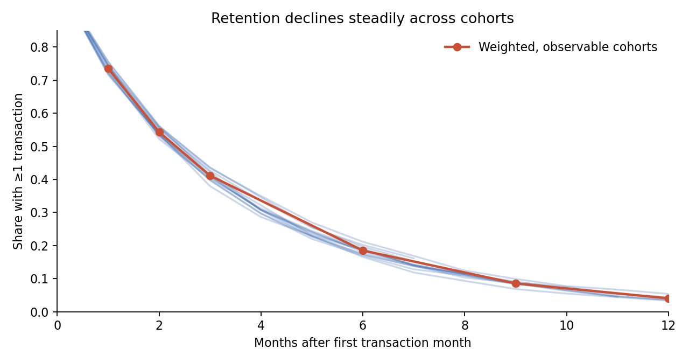
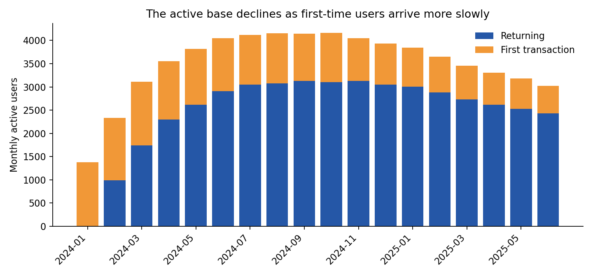
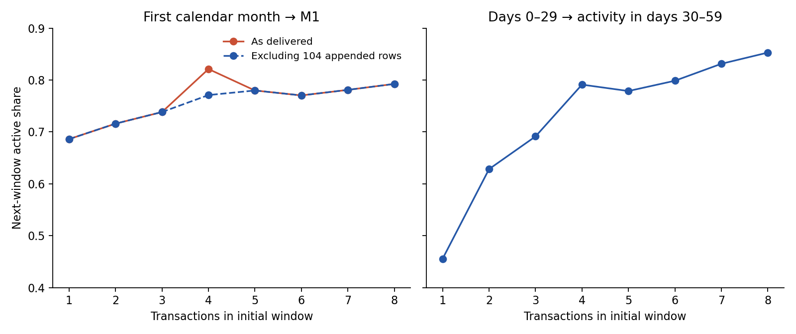

# BNPL retention: independent take-home answer

**Dataset:** 204,694 purchases by 18,000 users, January 2024–June 2025. The brief says six months; the file contains 18. All primary results use the CSV as delivered. [Reproducible code](analysis.py) and [audit tables](outputs/summary.json) accompany this report.

## Part 1 — Retention

### Q1a. Definition

A cohort is the month of a user's **first recorded BNPL purchase**. A user is retained at M*k* if they make at least one purchase in calendar month *k* after that month. The rate is retained users divided by all users in that cohort. This measures repeat product use, which the transaction file can observe. It does not measure healthy credit use: repayment, delinquency and account status are absent.

Monthly measurement fits a revolving product and the business reporting cycle. M0 can be a short exposure window for people whose first purchase is late in the month, so Q1c also uses equal 30-day windows. I include only cohorts whose follow-up month is fully present in the extract.

### Q1b. Cohort results

| Weighted retention, observable cohorts only | M1 | M2 | M3 | M6 | M12 |
|---|---:|---:|---:|---:|---:|
| Active user rate | **73.6%** | 54.3% | 41.2% | 18.5% | 4.1% |
| Eligible cohort users | 17,404 | 16,754 | 16,065 | 13,726 | 7,707 |

M1 varies from 71.6% to 76.0% across the 17 observable cohorts. The broad shape is similar, and retention keeps declining: this is a repeat-use problem throughout the user life cycle, with the largest absolute loss immediately after M0. These are descriptive comparisons; they do not prove the cohorts are identical. See the [full cohort matrix](outputs/cohort_retention_raw.csv).

The more striking pattern is the **shrinking inflow**. New users averaged 1,367 per month in Q1 2024 and numbered 596 in June 2025 (−56%). Monthly active users peaked at 4,162 in October 2024 and fell to 3,022 in June 2025 (−27%). In May 2025, 752 users stopped buying in June while 596 made their first purchase, producing a net loss of 156 users. This stock-and-flow accounting is consistent with falling acquisition plus persistent churn; the extract alone cannot locate the failing funnel step.

**Anomaly and hypotheses.** No user in the file buys again after a fully inactive calendar month, even among 14,226 users whose lapse had at least two later months in which a return could have appeared. A hard product or credit-status rule, an export that preserves only first activity streaks, or unusually low organic reactivation could explain this. Check account-status events and the extraction logic before treating this as a product fact. For the falling first-purchase count, inspect monthly eligible → invited → approved → first-purchase counts, channel mix and campaign spend. For early drop-off, inspect first statement, repayment, fees and account restrictions. These are hypotheses, not findings from the transaction table.

### Q1c. Is there a minimum first-month transaction count N?

**More early use is associated with higher M1 retention; no defensible unique N emerges.** On the delivered data, users with exactly one first-calendar-month purchase retain at 68.6%, while users with exactly four retain at 82.1%. A `≥4` split has the largest observed gap in the tested range: 79.5% versus 70.8%, or +8.7 percentage points. Choosing that threshold from the same data is exploratory, and the result is unusually sensitive to 104 transactions.

| First-month transactions | Users | M1, delivered CSV | M1, excluding flagged tail |
|---|---:|---:|---:|
| 1 | 5,414 | 68.6% | 68.6% |
| 2 | 3,531 | 71.6% | 71.6% |
| 3 | 2,843 | 73.8% | 73.8% |
| 4 | 2,074 | **82.1%** | **77.1%** |
| 5 | 1,358 | 78.0% | 78.0% |
| 6–8 | 1,683 | 77.8% | 77.8% |
| 9+ | 501 | 78.0% | 78.0% |

Transaction IDs `TXN00204591`–`TXN00204694` are appended outside the otherwise contiguous per-user ID blocks. Each belongs to a different user with four M0 purchases, and each adds an M1 purchase. Excluding them changes the exact-four rate by 5.0 points and the `≥4` split from +8.7 to +6.8 points. The pattern is suspicious, but an ID can also reflect a legitimate late-loaded purchase; **data engineering must verify source provenance before deletion**. The [threshold sensitivity table](outputs/threshold_sensitivity.csv) keeps both cases visible.

To remove unequal exposure in the first calendar month, I compared purchases in days 0–29 after each user's first purchase with activity in days 30–59, using only users with 60 observed days. The rate is 45.6% for one purchase, 62.8% for two, 69.1% for three, and generally rises further. The first-to-second step is the largest (+17.3 points), but a purchase count is also a marker of underlying intent and opportunity. The practical milestone is **a second purchase within 30 days to test**, not a claim that causing that purchase will increase retention by 17.3 points. See [equal-window results](outputs/equal_30_day_windows.csv).

## Part 2 — Option A: Churn

**Definition:** among users active in month *t*, churn for this analysis means no purchase in month *t+1*. June 2025 is excluded from the outcome calculation because July is absent. Overall, 24.9% of observed active user-months are followed by an inactive month; the rate over December 2024–May 2025 is 24.3%.

| Purchases in active month | User-months | No purchase next month |
|---|---:|---:|
| 1 | 16,601 | **29.9%** |
| 2–3 | 21,994 | 24.8% |
| 4+ | 21,651 | **21.0%** |

The frequency pattern remains after a simple comparison within tenure bands: direct standardisation to the common tenure mix gives 29.7%, 24.8% and 21.0% for the three groups. This is useful for prioritising outreach, but is **not an intervention effect**. More motivated users may both transact more and stay longer. Repeated user-months also mean these percentages are descriptive, not independent-trial causal estimates. The [stratified table](outputs/churn_by_tenure_and_frequency.csv) lets a reviewer inspect the pattern.

**Business decision.** Current inflow is too low to replace exits. At June's 3,022 active users, a 24.3% historical monthly exit rate implies roughly 733 first-time or reactivated users per month to hold the base, 137 more than June's 596 first-time users. The exact requirement changes with churn and reactivation, so use this as a planning check rather than a forecast.

1. **Growth + Risk: audit acquisition first.** Reconcile the extract with official MAU and trace eligible → invited → approved → first purchase monthly. Identify the step behind the decline; do not infer a marketing or credit-policy cause from purchase records alone. Success metric: recovered first purchasers without worse credit losses.
2. **Product + CRM: test an early second-use prompt.** Randomise eligible new users to an offer or reminder versus a holdout. Measure incremental M1 retention, second purchase within 30 days and net contribution after incentive and credit cost. Do not set a four-purchase target until the 104 records are explained.
3. **CRM: pilot a lapse reminder with a holdout.** Prior-month active users who have not transacted by mid-month are a reasonable contact group. Measure incremental transactions and next-month retention, rather than assuming a reminder saves them. Check contact fatigue.
4. **Risk + Data Engineering: clarify reactivation and balances.** Confirm whether an inactive account remains eligible, and join repayments, delinquency and account-status history before a win-back or credit-limit campaign.

## Part 3 — One-page decision brief

The standalone [business one-pager](ONE_PAGE.md) is the version for a lead who needs the decision without the methods.

## Bonus / data limits

- The file has 18 months despite the six-month description. Using all 18 exposes the shrinking acquisition pattern; verify that this is the intended extract.
- Exactly 18,000 users and zero return after a blank month may reflect sampling or export rules. Reconcile with production metrics before estimating business-wide impact.
- No transaction record shows repayment or losses. GMV and frequency therefore cannot stand in for lending profitability or credit health.
- The ID layout, smooth first-user decline, static limits and absence of reactivation suggest strong extract or generation rules. [Full data atlas](DATA_ATLAS.md) records the evidence; confirm provenance before extrapolating business impact.

For additional angles on acquisition, early-trigger timing, merchant breadth, credit-field quality and a runnable pilot dry-run, see [extended findings](NEW_ANGLES.md) and [pilot design](PILOT.md).
